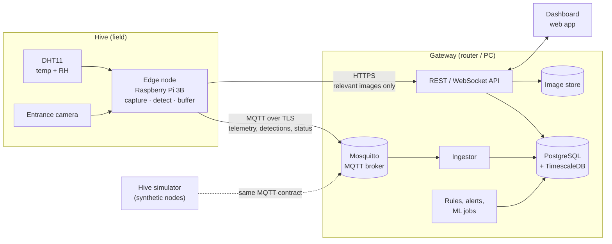

<div align="center">

# SmartHive

**Remote hive monitoring with edge computer vision, built by six students on free and open-source software.**


-blue)


[Documentation](docs/README.md) ·
[Architecture](docs/05-backend/01-architecture-overview.md) ·
[Data strategy](docs/04-data/01-data-problem-and-strategy.md) ·
[Vision](docs/03-vision/README.md) ·
[Roadmap](docs/roadmap.md) ·
[Decisions](docs/adr/README.md)

</div>

---

## What this is

Beekeepers usually find out about problems in a hive by opening it. That costs time, stresses the colony and often comes too late: by the time Varroa mites are visible on frames or a hornet has been hunting at the entrance for a week, the damage is done.

SmartHive is a monitoring node that sits on the hive and keeps watch between inspections. It measures the hive's internal climate, photographs the entrance, runs a pest detector on the device itself and sends the results to a small server that stores the history, raises alerts and feeds a dashboard.

The project is a functional demonstrator for a university course, not a commercial product. The goal is one working node on one real (or simulated) hive, with an honest evaluation of what works and what does not.

## What the first prototype does

| Capability | Prototype 1 (MVP) | Later |
|---|---|---|
| Internal temperature and humidity | DHT11 on the node | Better sensor, several probes |
| Hive weight | Simulated | HX711 + load cell |
| Entrance images | Camera on the node (model to be chosen) | |
| Pest detection | On-device: Varroa first, then hornets and small hive beetles | Server-side second opinion |
| Connectivity | Ethernet to a local gateway (router or PC) | LoRaWAN or cellular |
| Storage and alerts | Local server, email and in-app alerts | Push notifications |
| Training data | **Synthetic**, generated by this repo (procedural insects, simulated hives) | Field captures from the prototype |

There is no client dataset, and none is coming. Every model in this project is trained on data we generate ourselves. How we do that, and how we keep ourselves honest about it, is the subject of [docs/04-data](docs/04-data/README.md) and [docs/03-vision](docs/03-vision/README.md).

## Architecture at a glance



The node does the heavy lifting on images so that only small messages need to leave the hive. The server is a modular Python monolith in Docker Compose. The simulator speaks the same MQTT contract as a real node, so the backend and the dashboard can be built and tested before the hardware is ready. Details and reasoning are in [docs/05-backend](docs/05-backend/README.md).

## Repository map

```text
SmartHive/
├── docs/                 Project documentation (start at docs/README.md)
│   ├── 00-project/       Overview, team, way of working, risks, glossary
│   ├── 01-requirements/  Objectives, requirements, epics, user stories, open questions
│   ├── 02-hardware/      Node architecture, electrical design, power budget, review notes
│   ├── 03-vision/        Pest detection: problem, synthetic images, model, edge deployment
│   ├── 04-data/          The data problem and the synthetic data strategy
│   ├── 05-backend/       Backend architecture, stack, contracts, data model, API
│   ├── adr/              Architecture decision records
│   ├── jira/             Backlog for Jira: YAML source, generated CSV import, readable view
│   ├── roadmap.md        Plan for everything, including parts not yet designed
│   └── references.md     Papers, datasets and tools we rely on
├── simulation/           Synthetic telemetry and image generators      (working, tested)
├── vision/               Training, real-image eval, ncnn export, node pipeline (working)
├── models/               Released ncnn models with model cards               (v0.2)
├── edge/                 Software for the Raspberry Pi node            (planned; vision runtime done)
├── backend/              Ingestor, API, rules and alerts               (planned)
├── ml/                   Time-series models: yield, anomalies          (planned)
├── frontend/             Dashboard                                     (planned)
└── infra/                Docker Compose, broker config, certificates   (planned)
```

Each code folder already has a README that says what will live there, who owns it and which document describes it.

## Team

| Member | Area | Main responsibilities |
|---|---|---|
| James Tack | Backend and data | Ingestion, time-series database, REST API |
| Ricardo Villarreal | Embedded systems | Sensor node, sensors, power management, OTA |
| Adrien Cubilla | AI: signals and vision | Pest detection model, swarm acoustic classifier |
| Diego Alejandro Vasquez | AI: time series | Honey yield prediction, anomaly detection |
| Karen Jimenez | Communications | Gateway, MQTT over TLS, message format, LoRaWAN/NB-IoT |
| Maria de los Angeles Agudelo | Frontend and DevOps | Dashboard, alerts UI, integration, Docker, deployment |

Scrum Master: Diego Alejandro Vasquez. Product Owner: Adrien Cubilla. We work in two-week sprints; see [way of working](docs/00-project/way-of-working.md).

## Where we are

- [x] Requirements gathered and turned into epics and user stories
- [x] Functional architecture and electrical design of Prototype 1
- [x] Synthetic data strategy (vision and telemetry)
- [x] Backend architecture and FOSS stack
- [x] Hive telemetry simulator with stylized-fact tests ([docs](docs/04-data/02-hive-telemetry-simulator.md))
- [x] Procedural insect renderer and entrance-scene generator ([docs](docs/03-vision/03-synthetic-image-pipeline.md))
- [x] Real-image check set from the iNaturalist Open Dataset, frozen and license-checked
- [x] Two-stage detector trained on synthetic data, three iterations, release v0.2 in ncnn with a [model card](models/v0.2/MODEL_CARD.md); tier P accuracy 0.43 (chance 0.33), Pi 3B latency estimated at 0.24 s ([results](docs/03-vision/07-results.md))
- [x] Jira backlog ready to import ([docs/jira](docs/jira/README.md))
- [ ] Client interview: [30 open questions](docs/01-requirements/elicitation-matrix.md) still pending
- [ ] Camera model selected, real board backgrounds captured
- [ ] Node software running on the Pi
- [ ] End-to-end demo: node → server → dashboard → alert

The full plan, including work that is proposed but not designed yet, is in the [roadmap](docs/roadmap.md).

## Ground rules

- Everything is free and open source. There is no budget. Every tool in the stack has an OSI-approved license, and the [stack document](docs/05-backend/02-tech-stack.md) lists them. Where a popular tool changed its license (MinIO, Redis, parts of TimescaleDB), we say so and pick an alternative.
- Documentation is in English. Code, comments, commits and issues too.
- Decisions are written down. Anything that would be expensive to reverse gets an [ADR](docs/adr/README.md).
- Synthetic results are labeled as synthetic. A metric measured on generated data is never reported as if it came from a real hive.

## Contributing

Read [CONTRIBUTING.md](CONTRIBUTING.md) before your first pull request. It covers branches, commit messages, the definition of done and how docs are organized.

## License

Code: [GNU AGPL-3.0](LICENSE). The detector is trained with Ultralytics YOLO, which is AGPL-3.0, so the project follows the same license ([ADR-0008](docs/adr/0008-detector-licensing.md)). Anyone may use, study and change SmartHive, and anyone who runs a modified version as a service must publish their changes.

Data: the synthetic datasets are generated by code in this repository. From v0.2 on, half of their insects are cut out of iNaturalist photos under CC0 or CC BY, credited per photo in [`models/v0.2/ATTRIBUTION.tsv`](models/v0.2/ATTRIBUTION.tsv). The real-image check set links to iNaturalist photos under their own CC0 or CC BY licenses, listed per photo in [`vision/splits/P-inat-v1.tsv`](vision/splits/P-inat-v1.tsv). Vendored agent skills in `.claude/skills/` keep their own MIT and Apache-2.0 licenses.
