# SmartHive live demo

The whole product on one computer that has only Docker: five simulated hive nodes, the MQTT broker with mutual TLS, the ingestor, the alert worker, the API, the dashboard and a mailbox for the alert emails. One command starts it, one page lets the presenter trigger what goes wrong in a hive, and one command (`docker compose run --rm verify`) proves that every hop of the pipeline works. Nothing has to be installed or configured.

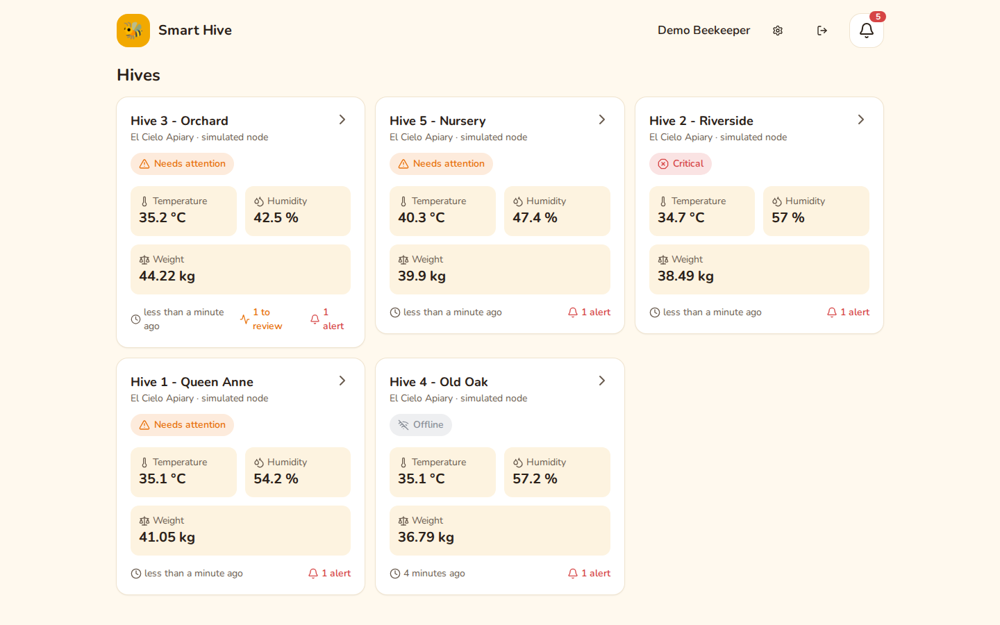

## What is real and what is simulated

| Part | In the demo |
|---|---|
| Node software (outbox, MQTT uplink, device token, retention filter, threat events, image upload) | **Real**: the same `pi_node` code the Raspberry Pi runs |
| Pest detection | **Real**: the project's YOLO11n v2 detector (`bee`, `varroa`, `wasp`), trained by Diego Alejandro Vásquez in [Pest_Threats_Detection](https://github.com/Smart-Hive-DSD-20262/Pest_Threats_Detection), runs on every frame. See [simulator/model/README.md](simulator/model/README.md) |
| Broker, ingestor, database, alert rules, API, WebSocket, email, dashboard | **Real**: the same images as `infra/docker-compose.yml` |
| Sensors (DHT11, HX711) | Simulated: values around a brood nest, shifted by the scenarios |
| Camera | Simulated: frames come from `simulator/corpus/`, real photographs from the BeeAlarmed BeeDataset (the dataset the model was trained on). The detections on them are the model's, not written by hand |
| History | Seven days of readings, weather and beekeeper log written at the first start (`smarthive demo-bootstrap`) |
| Alert time windows | Shortened for the demo (temperature out of range for 2.4 minutes instead of 2 hours; Varroa needs 100 classified bees instead of 300) |

Say this out loud in the presentation. The reviewers will ask, and the honest answer is a strength: only the hardware is replaced.

Two things to say about the model as well. First, the demo frames are photographs of the same dataset the model was trained on, so the demo proves that the *pipeline* works with the project's model, not how accurate the model is in a real hive (the model's repository lists a small validation set and possible train/validation leakage among its limitations). Second, the model has three classes: it detects bees, Varroa mites and wasps, and wasps and hornets are one class. The node reports its `wasp` as the `hornet` threat, and the model does not detect small hive beetles, so there is no beetle scenario.

## Requirements

- Docker Desktop 4.30 or later (Windows, macOS) or Docker Engine with the Compose plugin (Linux). Nothing else.
- 6 GB of memory given to Docker, 10 GB of free disk, an internet connection for the first build.
- Free ports: 8080 (dashboard), 8090 (control panel), 8025 (mailbox), 8883 (broker).

## Start from scratch

1. Get the code and open a terminal in the `demo` folder.

   ```bash
   git clone https://github.com/endlessconflict/SmartHive.git
   cd SmartHive/demo
   ```

2. Build and start everything. The first time takes 5 to 10 minutes (it downloads the base images and builds the frontend, the backend and the simulator); later starts take seconds.

   ```bash
   docker compose up -d --build
   ```

3. Wait until the stack is healthy, about a minute after the build. The `bootstrap`, `migrate` and `pki` containers end with `Exited (0)`: that is correct, they are one-time jobs.

   ```bash
   docker compose ps
   ```

   You should see `api` as `healthy` and `simulator`, `ingest`, `worker`, `mosquitto`, `db`, `caddy`, `frontend` and `mailpit` as `running`.

4. Open <http://localhost:8080> and sign in with `demo@smarthive.dev` and `SmartHive-Demo-2026`.

   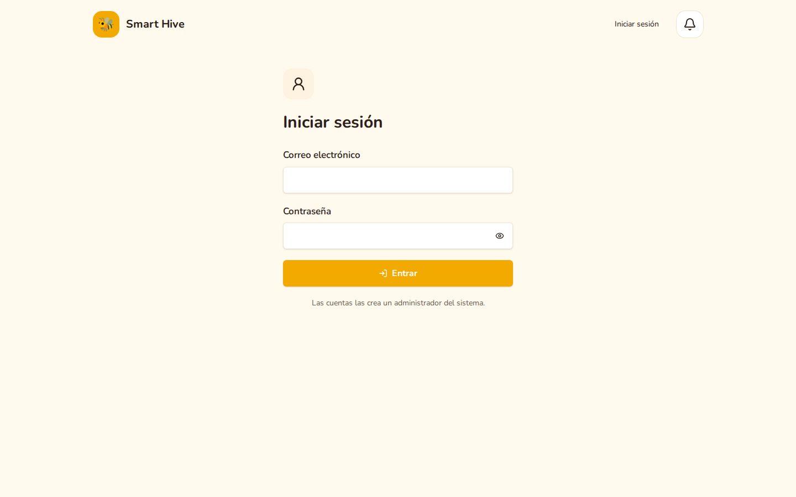

5. Open the control panel <http://localhost:8090> in a second window, and the mailbox <http://localhost:8025> in a third. Put the dashboard and the control panel side by side: the presenter clicks in one and the audience watches the other.

If something looks wrong, see [Troubleshooting](#troubleshooting).

## The tour (about 12 minutes)

### 1. A working apiary (2 min)

The dashboard shows five hives of one apiary, each with its node, temperature, humidity, weight and the time of the last message. Everything is live: a node sends a sample every 10 seconds.

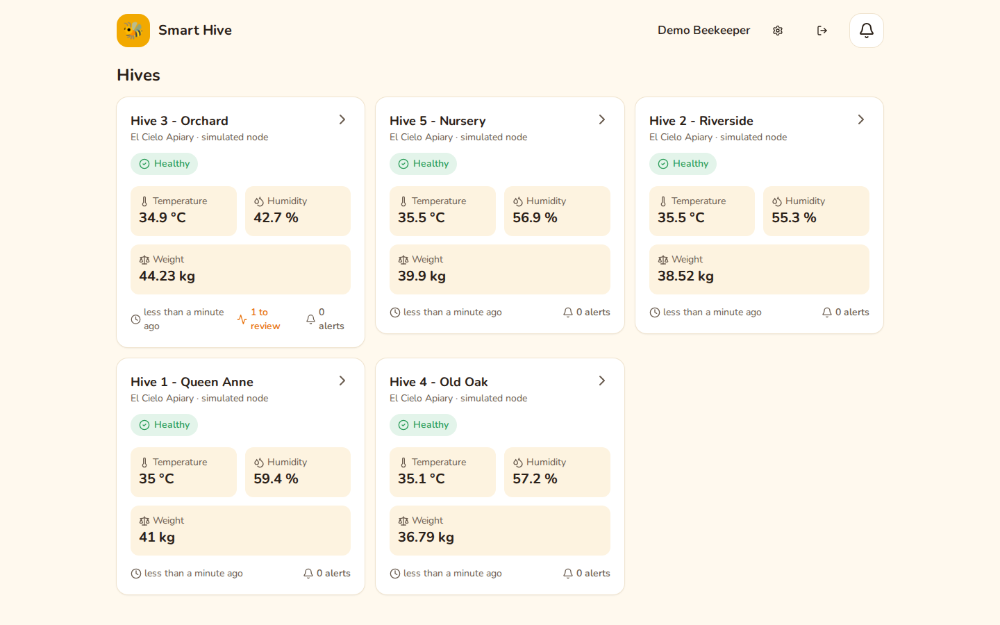

Open **Hive 3 - Orchard**. The humidity chart has a shaded band: the anomaly detector (US17) compared the hive with its own previous days and found the last four hours unlike them. It is a warning to review, never an alarm, and nobody is notified. The temperature and weight charts show a normal day: the brood nest holds 35 °C and the hive gains weight while the bees forage.

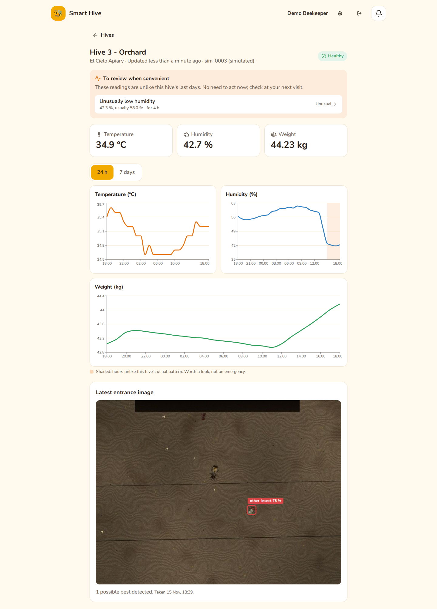

### 2. Hornet attack (3 min)

In the control panel, press **Hornet attack** on `sim-0002`.

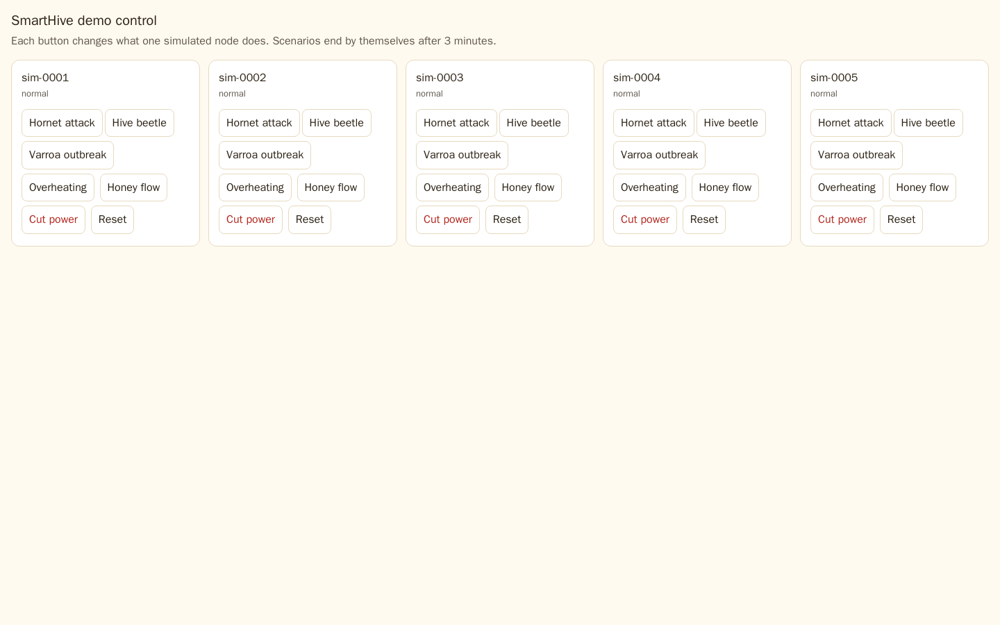

What happens, in order, and what to say:

1. The camera of node 2 starts to see a wasp or hornet. Every frame goes through the detector on the node.
2. The node's retention filter keeps the frames that matter (a threat above its threshold) and discards the rest. Only kept frames are stored and uploaded.
3. After three positive frames out of ten the node raises a `threat_detected` event over MQTT with mutual TLS.
4. The ingestor stores it, the alert worker opens a **critical** alert within 15 seconds, and the WebSocket pushes it to the dashboard without a refresh.
5. **Hive 2 - Riverside** turns red. Open it: the alert image shows the frame with the detector's box and confidence.

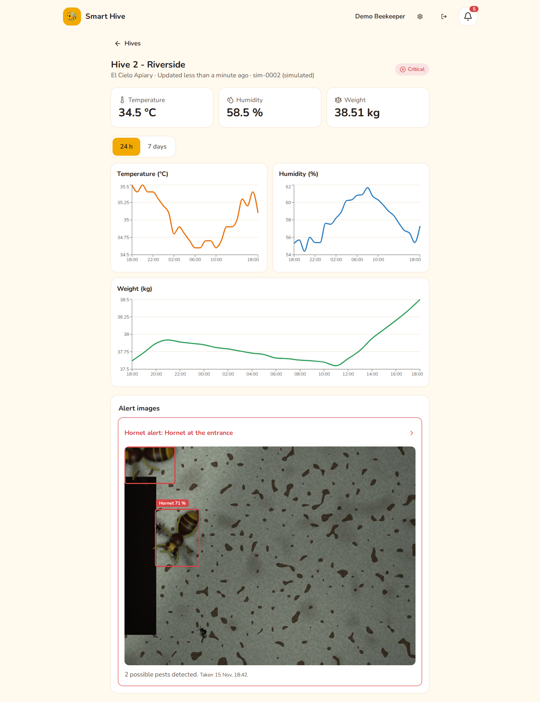

6. A critical alert is also emailed. Open the mailbox: the message carries the picture inline.

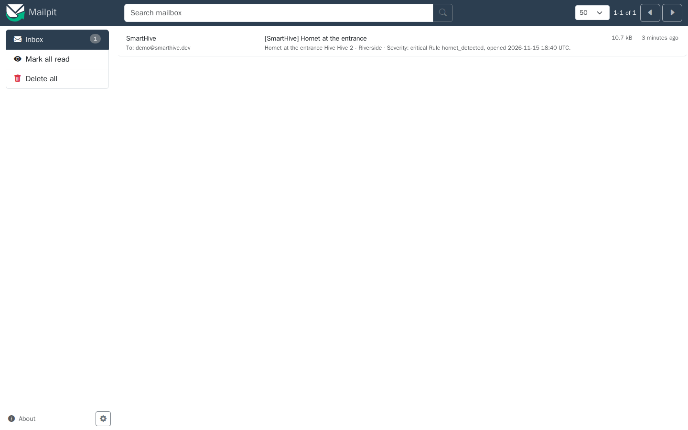

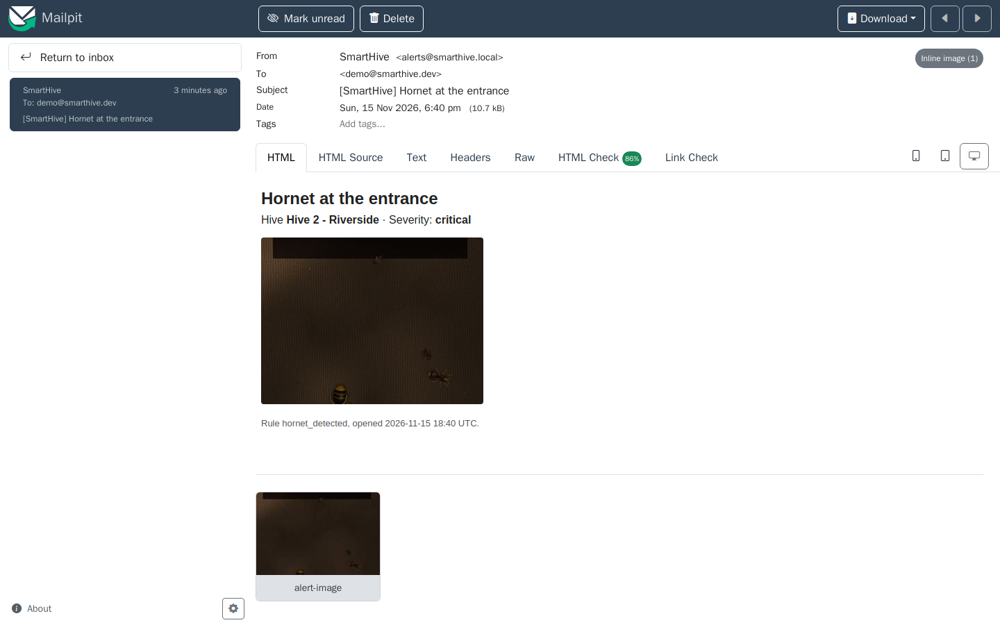

7. In the dashboard open **Alerts**, then the alert: its log shows who saw it and when. Acknowledge it and resolve it with a note, as a beekeeper would after closing the entrance.

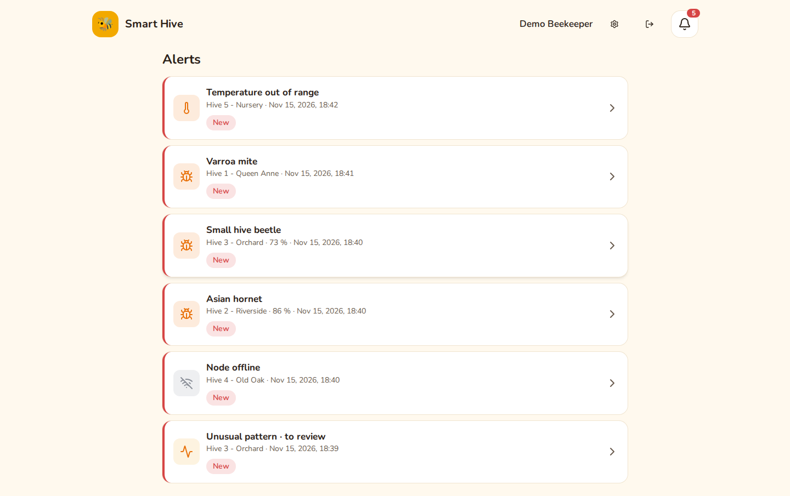

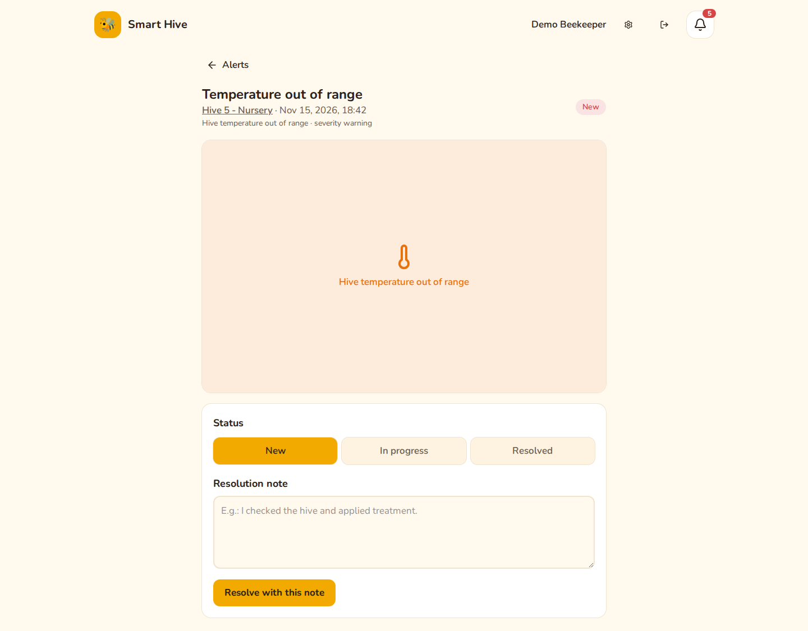

### 3. More things going wrong (3 min)

Press these in the control panel; each one lasts a few minutes by itself.

| Button | Node | What the audience sees |
|---|---|---|
| Varroa outbreak | `sim-0001` | Frames of bees with a mite, each mite boxed by the detector. After about two minutes the Varroa index (mites per bee seen) rises above 3 % and a warning opens. |
| Overheating | `sim-0005` | Temperature climbs to 40 °C. After 2.4 minutes (2 hours in production) the temperature rule opens a warning. |
| Cut power | `sim-0004` | The node stops. It announces `offline` and the hive card shows **Offline** with a node-offline warning. **Restore power** brings it back and the alert closes itself. |

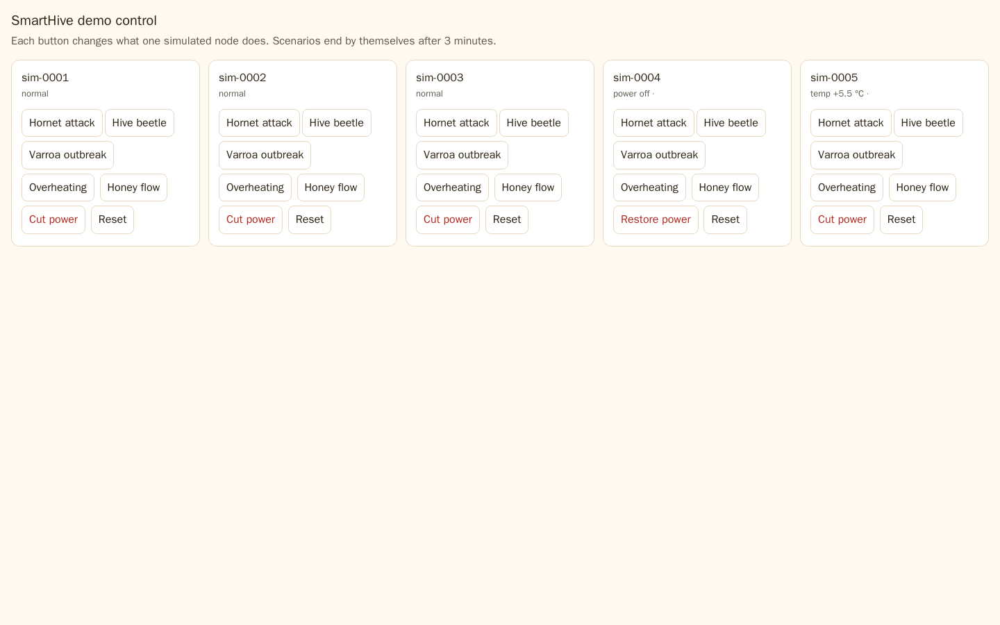

### 4. The network breaks and nothing is lost (2 min)

This is the part the reviewers remember. In a terminal:

```bash
docker compose stop mosquitto        # the field network is gone
```

Wait 60 seconds. The nodes keep measuring and keep every message in their local outbox (SQLite, survives a power cut). The dashboard stops updating. Then:

```bash
docker compose start mosquitto
```

Within seconds the nodes reconnect and send what they kept, oldest first. Open any hive: the charts have no hole. Each message carries its own id, so a message sent twice is stored once.

### 5. Behind the curtain (2 min, optional)

Security: the broker accepts only clients with a certificate signed by the project's own authority, and a node can publish only on its own topics.

```bash
# no certificate: refused
docker compose exec mosquitto mosquitto_sub -h localhost -p 8883 --cafile /mosquitto/certs/ca.crt -t '#' -W 3
#   Error: The connection was lost

# the backend's certificate: allowed to read what the nodes send
docker compose exec mosquitto mosquitto_sub -h localhost -p 8883 --cafile /mosquitto/certs/ca.crt \
  --cert /mosquitto/certs/backend.crt --key /mosquitto/certs/backend.key \
  -t 'smarthive/v1/nodes/sim-0001/telemetry' -v -C 1
```

On Windows with Git Bash, put `MSYS_NO_PATHCONV=1` before `docker`.

API: <http://localhost:8080/api/v1/docs> has the OpenAPI description of every endpoint.

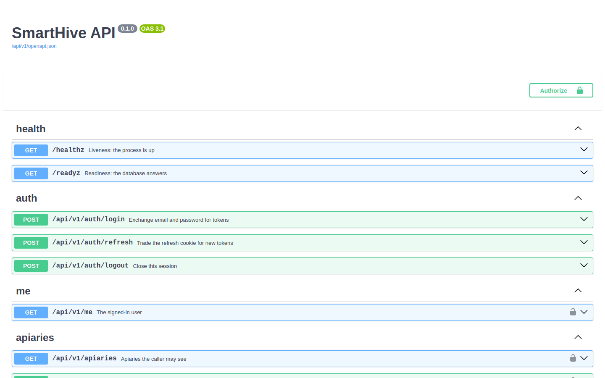

Setup: <http://localhost:8080/gestion> is where an administrator creates apiaries and hives and attaches a node to a hive. Detaching and attaching keeps the history of both.

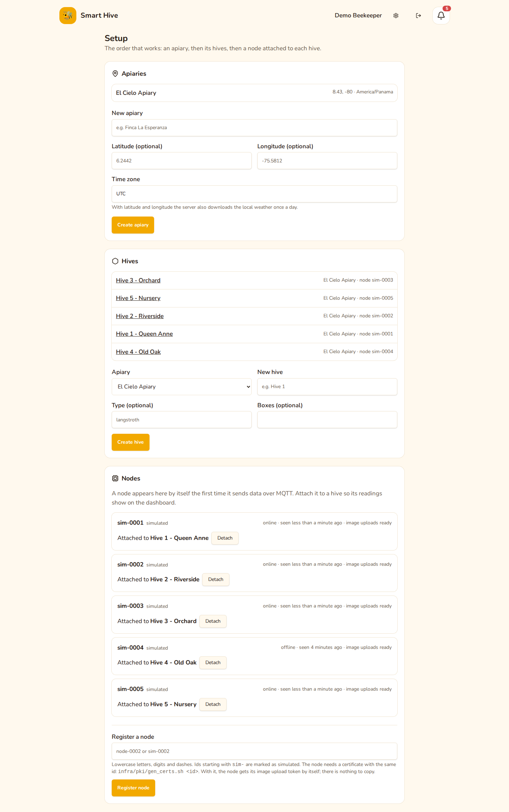

Backups: `docker compose exec api smarthive backup` writes a database dump now and prunes old ones. The nightly job does the same.

What the nodes are doing:

```bash
docker compose logs -f simulator    # kept frames, uploads, events
docker compose logs -f worker       # alert evaluation every 15 s
```

## Command line for the presenter

The control panel does the same as these commands.

```bash
docker compose exec simulator demo-ctl hornet sim-0002      # hornet | varroa | heat | swarm
docker compose exec simulator demo-ctl off sim-0004         # off | on
docker compose exec simulator demo-ctl reset all            # back to normal
```

`swarm` is a honey flow: the node's weight rises fast for three minutes.

## Prove that everything works

```bash
docker compose run --rm verify            # about 10 minutes
docker compose run --rm verify --quick    # about 6 minutes: skips the outage and restart tests
```

The verifier drives the running stack as a beekeeper, a node and an attacker would, and checks every hop of the pipeline with what it actually observes. It prints PASS or FAIL for each check, writes `demo/report/report.html` (checks by area, measured latencies, browser screenshots) and `report.json`, and exits with status 1 if anything failed, so a CI job can gate on it. Run it on a fresh stack (`docker compose down -v && docker compose up -d`).

| Area | What is checked |
|---|---|
| Platform | Every service running, one-shot jobs finished with exit 0, health and readiness, dashboard behind the proxy, OpenAPI |
| Security | No, garbage and tampered tokens; wrong password; refresh cookie flags, rotation and reuse detection; a beekeeper without hives sees nothing and cannot reach admin endpoints; upload without a device token; the broker refuses a client without a certificate; a node cannot publish or subscribe on another node's topics |
| Capture | Every node sends fresh, plausible, clock-synced values every ~10 s; a week of history is queryable |
| Pipeline | Four failures at once. For the hornet: the frame with the detector's box reaches the API, the event reaches the database through MQTT, a critical alert opens, it is pushed over the WebSocket, it lands unread in the inbox, the email arrives with the picture inline. For the others: the Varroa alert from the node summaries, the overheating alert, the power-cut alert and the offline status, the anomaly that never notifies, the weight rising with the honey flow. Latencies are measured |
| Dashboard | A real browser: wrong and right sign-in, five hive cards with the right status, values updating without a reload, charts drawn, the alert picture, the anomaly banner, the alert list and detail, the setup page, sign-out, and no JavaScript errors |
| Operations | Acknowledge and resolve with a note, the alert log, cooldown after resolving, inbox paging and read state, notification preferences, an inspection in the log, predictions and weather, tuning a threshold, CSV and JSON Lines exports with and without simulated data, image integrity by SHA-256, thumbnails, creating a hive and registering, attaching and detaching a node, cursor paging |
| Recovery | Power restored: the node comes back and its alert closes itself |
| Resilience | Broker down for a minute: the gap fills in afterwards with no duplicates; ingestor down: nothing lost; API restarted; a backup is taken and restored into a scratch database and the row counts match |
| Abuse | Repeated failed logins are rate limited; oversized uploads are cut off at the proxy |

The verifier mounts the Docker socket to stop and start services for the resilience tests. That is acceptable on a demo machine and is the reason it is not part of the default stack.

## Reset, stop, start again

```bash
docker compose down        # stop; the data stays for the next start
docker compose down -v     # forget everything, the next start rebuilds the week of history
docker compose up -d       # start again, no build needed
```

Resetting right before a presentation is the safest way to start: the alert list is empty, so every alert on screen is one the audience saw happen.

## Troubleshooting

| Symptom | What to do |
|---|---|
| `port is already allocated` | Another program uses 8080, 8090, 8025 or 8883. Stop it, or change the left side of the port in `docker-compose.yml`. |
| The build stops with `rpc error: EOF` | Docker Desktop was still starting. Run the command again. |
| Dashboard shows no hives | `bootstrap` has not finished. `docker compose logs bootstrap` should end with `demo apiary written`. |
| `verify` says it expected the five demo hives | It must run on a fresh stack: `docker compose down -v && docker compose up -d --build`, wait a minute, then run it. |
| Every hive says **Offline** | The simulator is still starting (it staggers the five connections). Wait a minute, or `docker compose logs simulator`. |
| No email arrives | Only critical alerts are emailed (hornet, and a node offline for 24 h). In the demo this includes simulated nodes; see `SMARTHIVE_NOTIFY_SIMULATED` in `docker-compose.yml`. |
| The simulator restarts in a loop | `docker compose logs simulator`. Usually the broker or the API was not ready; `docker compose restart simulator`. |
| Slow on a small machine | Give Docker more CPUs and 6 GB of memory. The detector runs on the CPU; with fewer than 4 cores frames are analyzed more slowly but everything still works. |

## What is in this folder

```text
demo/
├── docker-compose.yml        the whole stack
├── pki/                      one-shot job that creates the certificates (the same script as infra/pki)
├── simulator/
│   ├── sim.py                five nodes: the real pi_node code, simulated sensors and camera, the real detector
│   ├── detector.py           runs the YOLO11n v2 model with onnxruntime (letterbox, confidence 0.25, IoU 0.45)
│   ├── model/                the model as ONNX, with its source, checksum and the export recipe
│   ├── demo-ctl              change what a node does (the control panel calls the same code path)
│   ├── build_corpus.py       how corpus/ was made, and why every frame in it is one the detector agrees with
│   └── corpus/               32 frames of BeeDataset photographs: calm, hornet (wasp), Varroa, with a manifest
├── verify/                   the end-to-end verifier (docker compose run --rm verify)
└── guide/                    screenshots of this guide and the script that retakes them (capture.sh)
```

The backend side of the demo is `backend/src/smarthive/demo_bootstrap.py` (the account, the apiary, the week of history), tested in `backend/tests/integration/test_demo_bootstrap.py`.

To retake the screenshots after a change, with the stack running: `guide/capture.sh`. The verifier also saves its own screenshots in `report/img/`. It runs a headless browser in a container, so it needs nothing but Docker too.

The demo uses fixed passwords and certificates readable by every container. It is for demonstrations only; the real stack is `infra/docker-compose.yml`.
