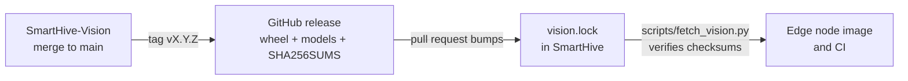

# Repositories

Status: Accepted

Owner: James Tack

SmartHive lives in two repositories. The split keeps the model work, which has large binary files, heavy dependencies and a release rhythm of its own, from slowing down everyone else.

| Repository | Holds | Main owners |
|---|---|---|
| [SmartHive](https://github.com/endlessconflict/SmartHive) (this one) | Documentation, backend, edge node software, infrastructure, frontend, time-series ML, the telemetry simulator, the Jira backlog | James, Ricardo, Karen, Maria, Diego |
| [SmartHive-Vision](https://github.com/endlessconflict/SmartHive-Vision) | Synthetic image generator, detector training and evaluation, released ncnn models, the node runtime (`smarthive_vision.pipeline`), the vision documentation and its ADRs | Adrien |

## How SmartHive uses the vision work

SmartHive never copies vision code. It pins a **release** of SmartHive-Vision, the way an application pins a library.



1. A model or runtime change is merged in SmartHive-Vision and tagged `vX.Y.Z`. The release workflow publishes the wheel, the models and `SHA256SUMS`.
2. Someone opens a pull request in SmartHive that edits [`vision.lock`](../../vision.lock) (version and the two checksums). The edge owner and the vision owner review it, because it changes what runs on the node.
3. `python scripts/fetch_vision.py --install` downloads that exact release, refuses it if a checksum differs, unpacks the models into `vendor/vision/` (git-ignored) and installs the wheel.

Why not a git submodule: a submodule pins a commit, not a tested release, and it makes every `git pull` a two-step operation for people who never touch the model. Why not a copy: the two sides drift apart and nobody notices which one is current.

## Rules that cross the boundary

- The detection event format that `pipeline.py` produces is a contract between vision, edge and backend ([contract owners](team-and-roles.md#contract-owners)). Adding a field is a minor release. Renaming or removing one needs the backend owner's approval before the vision release is tagged.
- ADR numbers are shared. Decisions about the whole product stay in [docs/adr](../adr/README.md). ADR-0008 to ADR-0011 are vision decisions and live in SmartHive-Vision; the index here links to them.
- A Jira story that spans both repositories names both pull requests in its comments.
- Credentials: the vision repository is private, so downloading a release needs `gh auth login` with access to it. CI in this repository does not need the vision release yet; when the edge tests start to, add a read-only token as a repository secret.

## Local setup

```bash
git clone https://github.com/endlessconflict/SmartHive.git
cd SmartHive
python scripts/fetch_vision.py          # only if you work on the edge node
```

Contributors to the model also clone SmartHive-Vision and follow its README.
