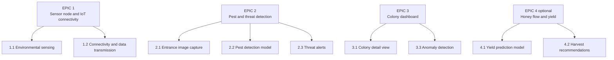

# Epics, features and user stories

Status: Accepted (translated from "Épicas, Features e Historias de Usuario")

Sprint assignments were blank in the source document. Priority 1 is must-have for the demo, 2 should-have, 3 could-have. Epic 4 is optional and depends on time left for a second model.

## EPIC 1: Sensor node and IoT connectivity

### Feature 1.1: Environmental sensing

| ID | Title | User story | Priority |
|---|---|---|---|
| US01 | Continuous internal temperature and humidity measurement | As a beekeeper, I want the hive to continuously measure internal temperature and humidity so that I can monitor environmental conditions remotely. | 1 |
| US02 | Continuous hive weight measurement | As a beekeeper, I want the hive to continuously measure its weight so that I can track nectar accumulation without a physical visit. | 1 |
| US03 | Local data storage and offline synchronization | As a beekeeper, I want the collected data to be saved locally if the Internet connection is lost, and synchronized once the connection is restored. | 2 |

### Feature 1.2: Connectivity and data transmission

| ID | Title | User story | Priority |
|---|---|---|---|
| US04 | Data encryption and in-transit protection | As a system administrator, I want hive information to be protected while it travels to the system, so that no one else can see or tamper with it. | 1 |
| US05 | Centralized data synchronization | As a system administrator, I want all hive information to arrive at one central place, so that every part of the system uses the same, consistent data. | 1 |
| US06 | Device connection loss and power alert | As a beekeeper, I want to be warned when a hive stops sending information, so that I can check whether the device has run out of power or lost its connection. | 2 |

## EPIC 2: Pest and threat detection

### Feature 2.1: Entrance image capture

| ID | Title | User story | Priority |
|---|---|---|---|
| US07 | Periodic hive entrance image capture | As a beekeeper, I want the system to capture periodic images of the hive entrance so that bee traffic and potential intruders can be analyzed automatically. | 1 |
| US08 | Storage optimization based on relevance | As a beekeeper, I want the system to store only images where something relevant is detected so that storage is used efficiently. | 2 |

### Feature 2.2: Pest detection model

| ID | Title | User story | Priority |
|---|---|---|---|
| US09 | Automated Varroa mite detection | As a beekeeper, I want the system to automatically identify Varroa mites on returning bees so that I can start treatment before the infestation spreads. | 1 |
| US10 | Small hive beetle and Asian hornet detection | As a beekeeper, I want the system to detect small hive beetles and Asian hornets at the entrance so that I can intervene before they damage the colony. | 1 |
| US11 | Edge AI detection model execution | As a beekeeper, I want the pest detection model to run directly on the sensor node so that detections happen even with limited connectivity. | 2 |

### Feature 2.3: Threat alerts

| ID | Title | User story | Priority |
|---|---|---|---|
| US12 | Multi-channel threat and pest notifications | As a beekeeper, I want to receive an in-app and email alert when a pest or intruder is detected so that I can act quickly without constantly checking the dashboard. | 1 |

## EPIC 3: Colony dashboard

### Feature 3.1: Colony detail view

| ID | Title | User story | Priority |
|---|---|---|---|
| US13 | Historical environmental data and trend view | As a beekeeper, I want to see how my hive's conditions have changed over time, so that I can understand how the colony is doing and spot problems early. | 1 |
| US14 | Alert history and response log | As a beekeeper, I want to see the alert history for a colony so that I can review past events and my responses to them. | 2 |
| US15 | Latest hive entrance camera image view | As a beekeeper, I want to see the latest entrance camera image for a colony so that I can visually confirm what the system detected. | 2 |

### Feature 3.3: Anomaly detection

(The source document has no Feature 3.2.)

| ID | Title | User story | Priority |
|---|---|---|---|
| US16 | Flagging unusual hive behavior patterns | As a beekeeper, I want the system to flag unusual hive behavior that does not match any known pattern so that I can investigate even when the cause is not yet identified. | 2 |
| US17 | Preventive anomaly dashboard warnings | As a beekeeper, I want anomalies to appear in the dashboard as a warning rather than a critical alert so that I can review them without feeling pressured to act immediately. | 2 |

## EPIC 4 (optional): Honey flow and yield optimization

### Feature 4.1: Yield prediction model

| ID | Title | User story | Priority |
|---|---|---|---|
| US18 | 7-day honey production yield estimation | As a beekeeper, I want the system to estimate how much honey my hive will produce in the next 7 days so that I can plan my harvest in advance. | 3 |
| US19 | Prediction range visualization | As a beekeeper, I want the prediction to be shown as a range rather than an exact number so that I understand there is inherent uncertainty in the estimate. | 3 |
| US20 | Weather data integration for yield accuracy | As a beekeeper, I want the system to combine hive weight data with local weather information to improve the accuracy of the yield prediction. | 3 |

### Feature 4.2: Harvest recommendations

| ID | Title | User story | Priority |
|---|---|---|---|
| US21 | Optimal honey super addition recommendation | As a beekeeper, I want to receive a recommendation when conditions are optimal to add a honey super so that I can maximize production without intervening too early. | 3 |
| US22 | Optimal honey harvest timing recommendation | As a beekeeper, I want to receive a recommendation when the honey is ready to harvest so that I do not extract too early or miss the right window. | 3 |

## Traceability: stories to components and data

This table is new. It shows, for each story, which software component implements it and what data it can be developed and tested with, given that there is no client data.

| Story | Component(s) | Can be built with | Blocked by |
|---|---|---|---|
| US01 | edge `sensord`, ingestor, telemetry table | Real DHT11 + simulator | Sensor placement (EL-03) |
| US02 | edge `sensord` (HX711), ingestor | Simulator only, until a load cell is wired | Load cell not in Prototype 1 schematic |
| US03 | edge outbox (SQLite), ingestor dedup | Simulator with injected outages | |
| US04 | Mosquitto TLS, device credentials | Any | Security scope (EL-28) |
| US05 | Ingestor, PostgreSQL | Simulator | |
| US06 | MQTT LWT, heartbeat rule, alerter | Simulator (kill a fake node) | Battery voltage sensing missing in hardware |
| US07 | edge `camd` | Real camera; synthetic frames for tests | Camera model |
| US08 | edge `camd` motion gate + `visiond` | Synthetic sequences | |
| US09 | `visiond` stage 2 classifier | **Synthetic images**, public data for validation | Camera resolution |
| US10 | `visiond` stage 1 detector | **Synthetic images**, public data for validation | |
| US11 | `visiond` on Pi 3B (NCNN) | Benchmarks on the real Pi | Pi hardware |
| US12 | Alerter, notification channels | Simulator detections | Channels and recipients (EL-17, EL-18) |
| US13 | API time-bucket queries, dashboard charts | Simulator history (a full synthetic year) | |
| US14 | Alerts and alert events tables, API | Simulator | Alert lifecycle (EL-20) |
| US15 | Image store, API | Synthetic images | |
| US16 | ML anomaly job | **Synthetic telemetry with labeled events** | Behavior for unknown anomalies (EL-25) |
| US17 | Alert severity "warning" | Simulator | |
| US18 to US20 | ML yield job, Open-Meteo client | **Synthetic telemetry** + real historical weather | Definition of yield (EL-10) |
| US21, US22 | Rules on predicted yield | Synthetic telemetry | Recommendation semantics (EL-11) |
