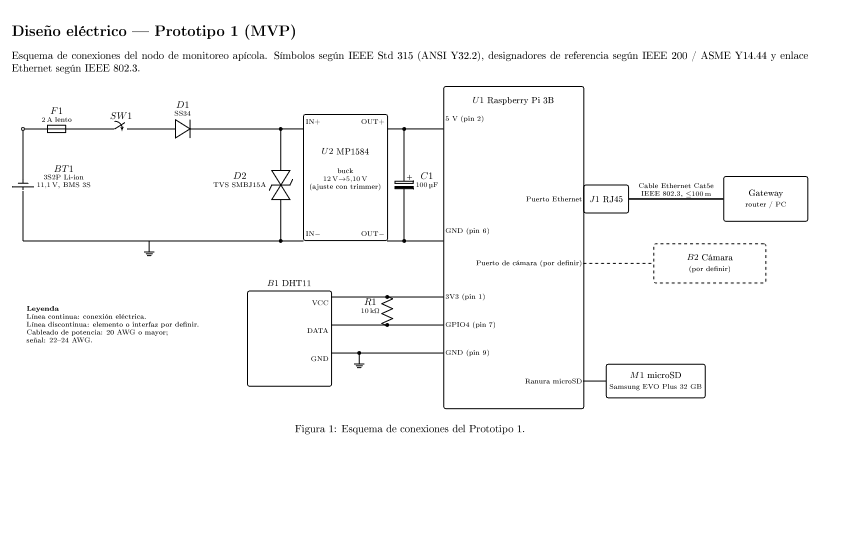
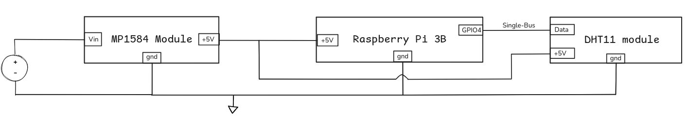

# Electrical design: Prototype 1 (MVP)

Status: Accepted for Prototype 1 (translated from "Diseño", section Electrical design)

Owner: Ricardo Villarreal

## Schematic

*Figure 1. Connection diagram of Prototype 1. Symbols per IEEE Std 315 (ANSI Y32.2), reference designators per IEEE 200 / ASME Y14.44, Ethernet link per IEEE 802.3. Solid line: electrical connection. Dashed line: element or interface still to be defined. Power wiring 20 AWG or thicker; signal wiring 22 to 24 AWG.*

An earlier block-level sketch of the same wiring:

## Bill of materials

| Ref | Component | Value / part | Function |
|---|---|---|---|
| BT1 | Battery pack | 3S2P Li-ion, 11.1 V nominal, with BMS 3S | Energy source |
| F1 | Fuse | 2 A slow-blow | Overcurrent protection on the battery line |
| SW1 | Switch | | Main power switch |
| D1 | Schottky diode | SS34 | Reverse polarity protection |
| D2 | TVS diode | SMBJ15A | Clamps voltage spikes on the input |
| U2 | Buck converter module | MP1584, 12 V → 5.10 V (trimmer adjusted) | Regulates battery voltage down to 5 V for the Pi |
| C1 | Electrolytic capacitor | 100 µF | Output bulk capacitance, absorbs load steps |
| U1 | Single-board computer | Raspberry Pi 3 Model B | Compute, control, storage, communication |
| B1 | Temperature/humidity sensor | DHT11 | Internal climate |
| R1 | Resistor | 10 kΩ | Pull-up on the DHT11 data line |
| M1 | microSD card | Samsung EVO Plus 32 GB | OS, data, images |
| J1 | RJ45 | Pi's onboard Ethernet port | Link to gateway |
| | Cable | Cat5e, IEEE 802.3, up to 100 m | Node to gateway |
| B2 | Camera | To be defined | Entrance images |

## Connections

| From | To | Signal |
|---|---|---|
| BT1 + | F1 → SW1 → D1 (anode → cathode) → U2 IN+ | Battery positive, protected |
| D2 | Across U2 IN+ and IN- | Transient suppression |
| U2 OUT+ | C1 + and Pi 5 V (pin 2) | 5.10 V supply |
| U2 OUT- / IN- | Common ground, Pi GND (pin 6) | Ground |
| Pi 3V3 (pin 1) | DHT11 VCC, and through R1 to the data line | Sensor supply and pull-up |
| Pi GPIO4 (pin 7) | DHT11 DATA | Single-wire bus |
| Pi GND (pin 9) | DHT11 GND | Ground |
| Pi camera port | B2 | To be defined (CSI ribbon or USB) |
| Pi Ethernet | J1 → Cat5e → gateway (router or PC) | Data link |
| Pi microSD slot | M1 | Storage |

The early wiring sketch powers the DHT11 from 5 V. The final schematic powers it from 3.3 V, which is the right choice: the DHT11 data line is pulled up to its supply, and the Pi's GPIO pins are not 5 V tolerant.

## Design notes

- The 3S pack swings from about 12.6 V (full) to about 9 V (empty). The MP1584 accepts up to 28 V input, so the whole range is fine. The SS34 drop (around 0.4 to 0.5 V) is acceptable at these voltages.
- The output is trimmed to 5.10 V rather than 5.00 V. The Pi flags under-voltage when its supply drops below about 4.63 V, and the extra margin covers cable and connector losses during load peaks.
- The MP1584 is rated for up to 3 A, while the Pi 3B's recommended supply is 2.5 A. Real consumption of a headless Pi 3B with a camera is well below that, but the module runs warm near its limit. Keep it ventilated inside the enclosure.
- The software reports the Pi's throttling and under-voltage flags (`vcgencmd get_throttled`) in its health messages, so a weak power design shows up in the data instead of as random crashes.

## What this design does not include yet

These items appear in requirements or user stories but not in the Prototype 1 schematic. The [review notes](hardware-review-notes.md) discuss each one.

| Missing | Needed for |
|---|---|
| HX711 + load cell | US02 weight, all of Epic 4 |
| Battery voltage/current sensing (for example INA219 or ADS1115 on I²C) | US06 "power alert": telling a dead battery apart from a lost connection |
| Real-time clock (for example DS3231 on I²C) | Correct timestamps after a cold boot without network |
| Microphone | Acoustic swarm detection (REQ-05) |
| Charging source (solar panel + charge controller) | Autonomy beyond about one day |
| Second temperature/humidity probe | US3 in the backlog: brood nest and honey super zones |
