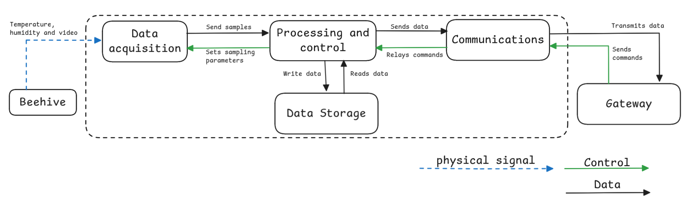
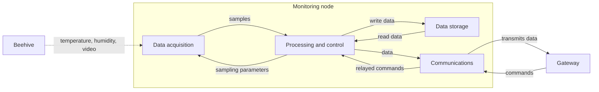
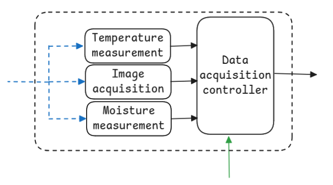

# Node functional architecture

Status: Accepted (translated from "Diseño", sections Architecture and Subsystem specification)

Owner: Ricardo Villarreal

## System view

The system is an autonomous monitoring node for one beehive. Its physical inputs are the environmental quantities to be measured: temperature, humidity and images of the entrance. Its control input is the commands and configuration sent by the user through the gateway. Its output is the data and metrics that describe the state of the hive, transmitted to the gateway. The node measures, processes, stores and transmits this information on its own. The view below shows how the subsystems relate through physical signals, data and control.

*Figure 1. Global view of the system. Blue dashed: physical signal. Green: control. Black: data.*

The same view as a Mermaid diagram, so it can be edited in text:

Open items from the original document: whether to add a power subsystem to this view (yes, it should be added, because power state drives US06 and the autonomy requirements), and the written justification of each subsystem against the requirements.

## Subsystems

| Subsystem | General function | Inputs | Outputs |
|---|---|---|---|
| Data acquisition | Converts physical quantities of the hive, such as temperature and humidity, into digital samples | Physical signals from the hive, sampling order | Digitized samples |
| Processing and control | Coordinates the node: processes samples, schedules sampling, decides what to store and send, interprets commands and acknowledgements | Digitized samples, stored data, commands, ACKs | Sampling order, data to store, data to transmit |
| Communications | Manages the link with the gateway: transmits data and receives commands, configuration and acknowledgements | Data to transmit, commands, remote configuration | Transmitted data, relayed commands and ACKs |
| Data storage | Keeps data locally until it is confirmed as sent | Processed data to store | Stored data |

### Data acquisition

*Figure 2. Data acquisition subsystem. "Moisture measurement" in the figure means relative humidity.*

Blocks: temperature measurement, image acquisition, humidity measurement, data acquisition controller.

Converts the physical quantities of the hive (temperature, humidity and images) into digital samples. The physical signal passes through the measurement and acquisition modules, coordinated by an acquisition controller that sets the sampling frequency and hands the data to the rest of the node.

### Processing and control

Blocks: image preprocessing, inference/detection, data management, command processing.

Receives the samples from the acquisition subsystem and processes them locally. Images are preprocessed and then fed to the inference model for pest detection. It also manages the acquired data and the information produced by processing, and coordinates handing it to the storage and communication subsystems.

### Communications

Blocks: data reception, data preparation, data transmission.

Manages the exchange of information between the embedded node and external systems. It receives the data produced by the other subsystems, prepares it for the communication mechanism in use and transmits it. It also receives information from the external system for configuration, control or data requests.

### Data storage

Blocks: storage of acquired data, storage of processed information.

Stores locally the data acquired by the node, including environmental measurements and captured images, plus the information produced by processing, such as detection results and their metadata. Local storage keeps the information available for later query or transmission, even when communication is down.

## Physical allocation

| Block | Subsystem | Candidate physical element |
|---|---|---|
| Temperature measurement | Data acquisition | Temperature sensor |
| Humidity measurement | Data acquisition | Humidity sensor |
| Image acquisition | Data acquisition | Camera |
| Acquisition control | Data acquisition | Compute unit |
| Image preprocessing | Processing and control | Compute unit |
| Inference / detection | Processing and control | Compute unit |
| Data management | Processing and control | Compute unit |
| Data preparation for transmission | Communications | Compute unit |
| Data transmission | Communications | Communication module / interface |
| Data reception | Communications | Communication module |
| Storage of acquired data | Data storage | Non-volatile memory |
| Storage of processed information | Data storage | Non-volatile memory |

## Preliminary component selection

| Block | Implementation element | Candidate component | Main selection criterion |
|---|---|---|---|
| Temperature measurement | Temperature sensor | DHT11 | Digital temperature output, combined with humidity, low power |
| Humidity measurement | Humidity sensor | DHT11 | Digital relative humidity output, low power |
| Image acquisition | Camera | To be defined | Resolution, interface with the compute unit, capture capability |
| Acquisition control, preprocessing, inference, data management, data preparation | Compute unit | Raspberry Pi 3 Model B | Processing capacity, available interfaces, runs node control and the detection model locally |
| Data transmission and reception | Communication module | Ethernet cable for the MVP | (Final target: low power, long range) |
| Storage | Non-volatile memory | Samsung EVO Plus 32 GB microSD | Capacity, write endurance, local storage |
| Power management | Power and regulation system | MP1584 buck converter | Autonomy, efficiency, protection, regulated output voltages |

The original table asked to "define memory: 1 GB, 2 GB or 4 GB" for the Raspberry Pi 3B. That choice does not exist for this board; see the [hardware review notes](hardware-review-notes.md#2-the-raspberry-pi-3b-has-1-gb-of-ram-and-no-other-option).

## How the software maps onto these subsystems

The four subsystems become four groups of services on the Pi. Details in [edge node software](../05-backend/03-edge-node-software.md).

| Subsystem | Software on the node |
|---|---|
| Data acquisition | `sensord` (DHT11, later HX711), `camd` (camera + motion gate) |
| Processing and control | `visiond` (two-stage detector), `agentd` (config, commands, health) |
| Data storage | SQLite outbox and local image folder |
| Communications | `uplinkd` (MQTT over TLS, HTTPS image upload) |
