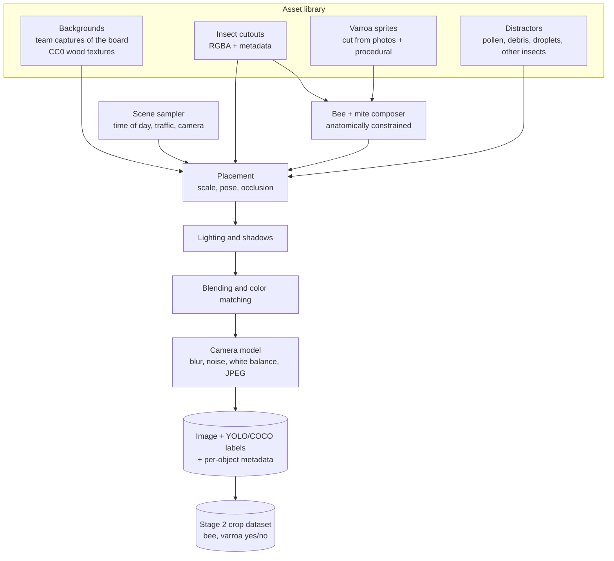
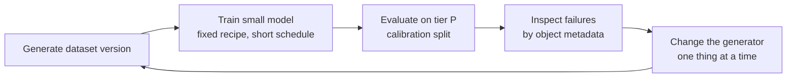

# Synthetic image pipeline

Status: Proposed

Owner: Adrien Cubilla

Code: `simulation/images/` (planned)

## The idea

We cannot photograph thousands of Varroa-infested bees, hornet attacks and small hive beetles at our own entrance. We can photograph our entrance board, and we can collect real photos of each insect from openly licensed sources. The generator combines the two: it cuts insects out of real photos and pastes them onto real backgrounds, following the geometry of our camera, with randomized lighting, shadows, blur and sensor noise. Labels come for free, since the generator knows where it put everything.

This is the "cut, paste and learn" approach. Dwibedi et al. (ICCV 2017) showed that detectors care mostly about local, patch-level realism, not about whether the whole scene makes sense, and that synthetic composites plus a small amount of real data can match or beat training on real data alone in a cross-domain setting. Ghiasi et al. (CVPR 2021) showed that even naive random pasting is a strong augmentation, especially for rare classes. Our rare classes are exactly the ones we care about.

## Three routes, one main path

| Route | What | Status | When to use |
|---|---|---|---|
| A. 2D compositor | Real cutouts on real backgrounds, physically motivated placement and camera model | **Main path, v1** | Everything, from day one |
| B. 3D rendering | Blender + BlenderProc scenes with insect 3D models and domain randomization | Optional, v2 | If route A lacks pose variety, mainly for close-up Varroa-on-bee crops |
| C. Generative refinement | A diffusion model to add variety to backgrounds or a light realism pass | Optional, experimental | Only if A and B leave a clear realism gap, and only with label checks |

Route A is cheap, runs on any laptop, and every step is understandable. Routes B and C cost more and add risk, so they have to earn their place by improving tier P metrics.

## Pipeline (route A)



### 1. Asset library

#### Backgrounds

| Source | How many | Notes |
|---|---|---|
| Team captures of the empty landing board with the real camera (tier C) | 200+ | The most valuable asset. Different times of day and weather. See [camera and optics](02-camera-and-optics.md#team-captures-tier-c-to-make-now) |
| Photos of other entrance boards and hive fronts (openly licensed) | 100+ | For variety; correct scale is approximate |
| CC0 wood and paint textures (ambientCG, Poly Haven) | 50+ | Rendered flat with random lighting as extra boards |

Backgrounds are stored with their px/mm (from the ruler frame) and the entrance position and direction (two clicks per image), so the placement step knows where bees go.

#### Insect cutouts

| Class | Sources (license-checked) | Target count |
|---|---|---|
| `bee` | Public datasets that allow derivatives; iNaturalist and Wikimedia Commons photos (CC0, CC BY); team photos | 300+ cutouts, several views (dorsal, angled, flying) |
| `hornet` | iNaturalist, Wikimedia Commons; VespAI material if its license allows | 100+ |
| `shb` | iNaturalist, Wikimedia Commons (no dedicated dataset exists) | 80+ |
| `other_insect` | Flies, wasps, ants, moths, native hornets from the same sources and from Insect Detect data | 200+ |

Cutting out:

1. Segment Anything 2 (SAM 2, Apache-2.0) with one or two click prompts per insect gives a mask in seconds.
2. A person checks each mask, especially wings and legs, in a small review tool (FiftyOne or Label Studio).
3. Each cutout is saved as an RGBA PNG with metadata: class, view, body length in pixels, head direction (two clicks: head and tail), source asset ID, license.

For bees, the reviewer also draws **mite anchor regions**: polygons over the dorsal thorax and the visible parts of the abdomen where a mite can sit. This takes a few seconds per bee and is what makes the next step anatomically plausible.

#### Varroa sprites

Two sources, mixed:

- Real mites cut from high-resolution photos, for example the sticky-board images in Zenodo 10231845 (license to verify) and openly licensed close-ups. Real texture and color.
- Procedural mites drawn by code: a slightly flattened ellipse, 1.6 × 1.1 mm at the target scale, reddish-brown with randomized hue and saturation, a darker rim, a glossy highlight whose position follows the light direction, and faint leg hints on one side. Unlimited variety and no license questions. These also teach the model shape rather than one particular photo's pixels.

#### Distractors and look-alikes

The hardest negatives for stage 2 are things that look like a mite on a bee: **pollen loads** (often orange to dark red), dark wing bases, the bee's own dark abdominal bands, debris stuck to hair. The library includes pollen pellets on bee legs, wax flakes, dirt specks, water droplets, propolis stains on the board, dead bees and leaves. A good share of training crops must be bees with these and no mite.

### 2. Bee + mite composer

Creates `bee_varroa` cutouts from clean bee cutouts:

1. Draw the number of mites: 1 most of the time, 2 sometimes, 3 rarely.
2. Pick a point inside the bee's mite anchor regions.
3. Scale the mite to the bee: mite width ≈ 1.6 mm, bee length ≈ 12 to 15 mm, so the mite width is about 11 to 13 % of the bee length; randomize ±15 %.
4. Orient the mite with its long axis roughly across the bee's body axis, ±30°.
5. Partly hide it under the wing mask sometimes, with partial transparency for the wing membrane.
6. Match the mite's brightness and color temperature to the bee region it sits on.
7. Record the mite's position and visible fraction, so stage 2 can also be evaluated by difficulty.

### 3. Scene sampler

Each image starts with a sampled scene:

| Variable | Distribution | Source of truth |
|---|---|---|
| Time of day | Weighted towards daylight foraging hours | Telemetry simulator's activity curve |
| Sun elevation and azimuth | From time of day and site | astral |
| Sky | Sunny / partly cloudy / overcast | Weather draw |
| Traffic (bees on board) | Poisson, mean from activity, 0 to ~40 | Telemetry simulator |
| Camera px/mm | Configured value ±20 % | Ruler frame |
| Camera tilt | 0 to 15° from vertical (small homography) | Mounting |
| Pest presence | Per class, much more often than in reality (training sets are rebalanced) | Config |

Linking the scene to the telemetry simulator's clock and colony state keeps the two synthetic worlds consistent, which matters later for fusing vision and sensor data.

### 4. Placement

- Walking bees cluster near the entrance and along paths in and out. Orientation follows a von Mises distribution around the entrance axis (towards or away), plus some random.
- Flying bees are fewer, larger (closer to the lens), slightly out of focus and motion-blurred.
- Hornets hover near the entrance (flying cutouts, blurred wings) or land briefly at the edge.
- Beetles appear on the board near the entrance or at its edges.
- Overlap is allowed (bees crowd), with a cap per pair. Objects are drawn back to front; labels use the visible part, and an object less than 30 % visible is dropped from the labels but kept in the image.

### 5. Lighting and shadows

- Global brightness and color temperature from sun elevation and sky.
- Hard drop shadows on sunny scenes: the object mask, offset along the sun direction by an amount that depends on elevation, blurred slightly, multiplied into the background. Soft, faint shadows on overcast scenes.
- Cutouts are relit to match: brightness and white balance adjusted towards the local background statistics (Reinhard-style color transfer in Lab space), with a random strength so the model does not learn that pasted objects always match perfectly.

### 6. Blending

A mix of methods, chosen at random per object, so the model cannot learn the signature of one blending method:

- Alpha blending with a feathered mask (1 to 3 px).
- Poisson blending (`cv2.seamlessClone`), which adapts colors at the boundary.
- Plain alpha with a slightly eroded mask.

Dwibedi et al. found that mixing blending methods and training on all of them works better than any single one.

### 7. Camera model

Applied to the whole image last, in this order:

| Effect | Range | Calibrated from |
|---|---|---|
| Lens distortion (barrel) | Small k1 | Ruler frame |
| Defocus blur | Gaussian, per depth band | Depth of field estimate |
| Motion blur | Directional kernel per object, length from speed × exposure | Blur table in [camera and optics](02-camera-and-optics.md#motion-blur) |
| Vignetting | Mild radial falloff | Gray card frames |
| Sensor noise | Poisson-Gaussian, gain-dependent | Gray card frames at several light levels |
| White balance error | ±500 K equivalent | |
| Sharpening | Light unsharp mask, sometimes | Camera's own processing |
| JPEG compression | Quality 70 to 95 | What the node will store |

### 8. Output

```text
data/sim/S-images-entrance_composite-v0.3-s7/
├── DATASET_CARD.md
├── assets.lock
├── ATTRIBUTION.md
├── images/{train,val}/000001.jpg
├── labels/{train,val}/000001.txt          YOLO format
├── annotations.coco.json                  COCO format
├── objects.parquet                        per object: asset_id, class, box, visibility, blur_px, n_mites, mite boxes, lighting
└── crops/                                 stage 2 dataset
    ├── images/...                         128x128 bee crops with padding
    └── labels.parquet                     varroa (0/1), n_mites, mite boxes, blur score, distractors present
```

`objects.parquet` makes it possible to break down any metric by difficulty: small objects, heavy blur, partial occlusion, look-alike distractors.

### 9. Sequences (v2)

The motion gate and the temporal aggregation rule need short sequences rather than single frames. Version 2 of the compositor moves objects along trajectories (random walks with drift towards or away from the entrance, hornets hovering) and renders 2 to 5 fps clips of 10 to 30 s. Same assets, same camera model.

## Route B: 3D rendering (optional)

Blender (GPL) with BlenderProc (GPL-3.0, from DLR) can place 3D insect models on a board, randomize camera pose, lights, materials and HDRI environments, and export COCO boxes and segmentation masks directly.

What it buys: viewpoints and occlusions that cutouts cannot produce, particularly for close-up bee crops with mites seen from many angles.

What it costs: openly licensed, anatomically decent 3D models of a bee, a hornet and a beetle (some exist under CC BY; each must be checked) or modeling time in Blender, plus CPU render time. Cycles is slow on laptops; Eevee is faster and good enough for this.

Decision rule: start route B only if, after two iterations of route A, stage 2 errors on the tier P calibration split are dominated by viewpoint problems.

## Route C: generative refinement (optional, experimental)

Diffusion models can produce varied backgrounds, or "repaint" a composite to look more photographic. Two problems for us:

1. Licenses. Our rule is OSI-approved licenses only. FLUX.1 [schnell] is Apache-2.0 and qualifies. Many popular Stable Diffusion checkpoints use OpenRAIL-style licenses with use restrictions, which are not OSI open source, so they are out.
2. Compute and labels. FLUX.1 [schnell] has 12 billion parameters; its transformer alone is about 24 GB at bf16, far beyond a laptop. Free GPU notebooks (Kaggle, Colab) are free of charge but are not open-source platforms; whether that is acceptable is a team decision. And any repainting can move or erase a mite, which silently breaks labels.

If tried: use it only for backgrounds (no labels involved), or for a low-strength pass over composites followed by an automatic check that every labeled object is still there (stage 1 detector agreement) and a manual spot check.

## Quality control

| Check | How | When |
|---|---|---|
| Look at it | FiftyOne grid of 200 random images per version, reviewed by someone who did not write the change | Every version |
| Size distributions | Object sizes in px match the camera math; mite sizes in crops match 1.1 × 1.6 mm at the configured px/mm | Automated test |
| Label sanity | Re-render boxes on images; zero boxes outside the image; visibility rule respected | Automated test |
| Distribution distance | KID or FID between synthetic images and tier C / tier P calibration images | Trend only; lower is not automatically better |
| What counts | Train-on-synthetic, test-on-real (TSTR) on the tier P calibration split | Every version |
| Ablations | Turn off one randomization at a time (shadows, blur, noise, color matching, distractors) and measure the TSTR change | Once per major version |

## Iteration loop



Each loop is time-boxed (about one week per iteration within a sprint). A change to the generator is kept only if it improves TSTR or fixes a failure category without hurting another. The test split is never used inside this loop.

## Volume targets

| Version | Images | Stage 2 crops | Goal |
|---|---|---|---|
| v0.1 | 2,000 | 10,000 | Pipeline runs end to end; first TSTR number |
| v0.5 | 10,000 | 30,000 | Shadows, blur, noise, distractors; ablations |
| v1.0 | 20,000+ | 50,000+ (about 30 % with Varroa) | Model for the Pi benchmark and the demo |

On a laptop CPU the compositor should produce a few images per second, so v1.0 takes hours, not days.

## Configuration sketch

```yaml
name: entrance_composite
version: 0.3
seed: 7
output: {size: [1640, 1232], jpeg_quality: [70, 95], splits: {train: 0.9, val: 0.1}}
camera:
  px_per_mm: {mean: 8.5, rel_sd: 0.1}
  tilt_deg: [0, 15]
  noise_profile: calib/camera_noise.yaml
  exposure_s: [0.0005, 0.004]
scene:
  time_of_day: {from: telemetry_activity}
  sky: {sunny: 0.5, partly: 0.3, overcast: 0.2}
  bees_per_image: {dist: poisson, mean_from: telemetry_traffic, max: 40}
classes:
  hornet: {p_image: 0.25, count: [1, 2]}
  shb: {p_image: 0.15, count: [1, 3]}
  other_insect: {p_image: 0.4, count: [1, 4]}
varroa:
  p_bee: 0.15
  mites_per_bee: {1: 0.8, 2: 0.17, 3: 0.03}
  sprite_mix: {real: 0.5, procedural: 0.5}
distractors:
  pollen_on_bee: 0.3
  debris_per_image: [0, 8]
blending: {alpha_feather: 0.4, poisson: 0.3, eroded_alpha: 0.3}
```

## Libraries

| Library | License | Use |
|---|---|---|
| OpenCV | Apache-2.0 | Blending, warping, blur, color spaces |
| NumPy, SciPy | BSD | Everything numeric |
| Pillow | HPND (MIT-CMU) | Image I/O |
| torchvision transforms v2 | BSD-3 | Training-time augmentation |
| SAM 2 | Apache-2.0 | Cutout masks |
| FiftyOne | Apache-2.0 | Dataset browsing and review |
| astral | Apache-2.0 | Sun position |
| Blender, BlenderProc | GPL | Route B only |

Albumentations is a common choice for augmentation, but the project changed its licensing model in 2025. Check the current license of whichever version is installed before adopting it; torchvision covers what we need.
