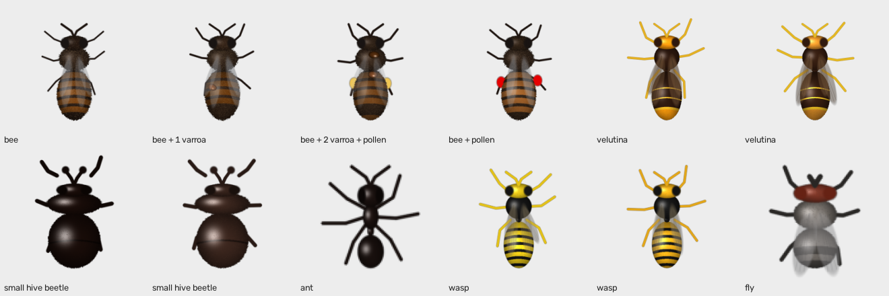
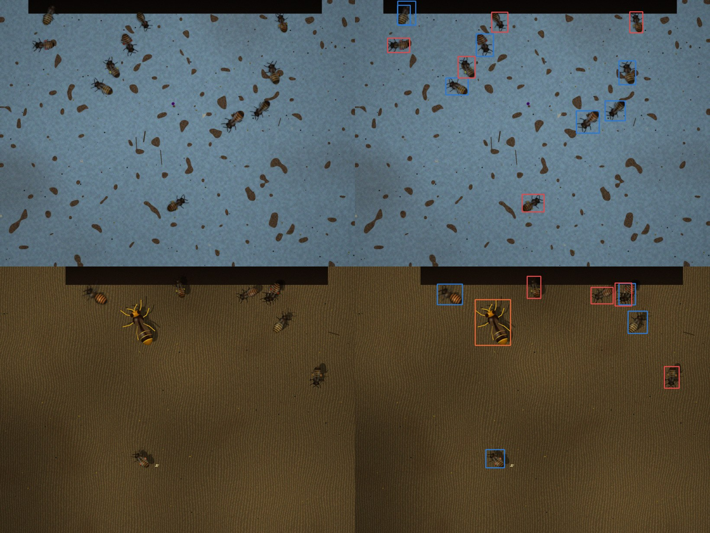
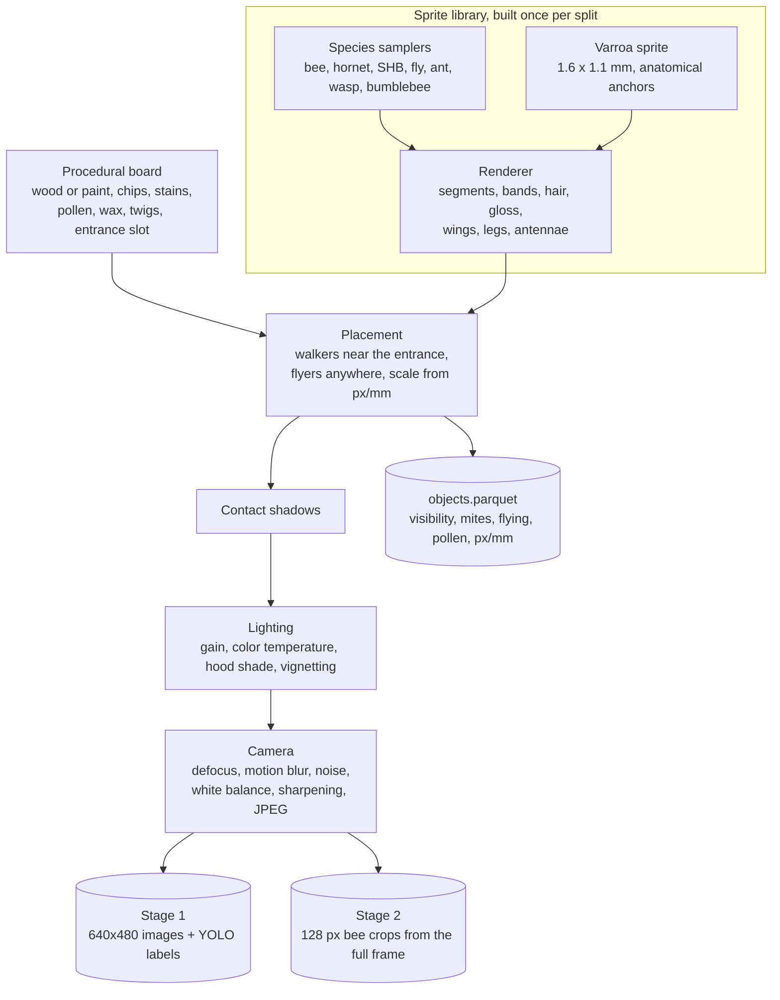

# Synthetic image pipeline

Status: Implemented (v0.1). Iteration results are in [07-results.md](07-results.md).

Owner: Adrien Cubilla

Code: [`simulation/images/render.py`](../../simulation/images/render.py) (procedural insects), [`simulation/images/compose.py`](../../simulation/images/compose.py) (scenes and labels), [`simulation/images/test_images.py`](../../simulation/images/test_images.py)

```bash
python -m simulation.images.render                     # contact sheet of sprites in /tmp
python -m simulation.images.compose --out data/sim/S-images-entrance-v0.1-s1 --n 4000 --seed 1
```

## The idea

We have no labeled entrance images, and the network we built this on cannot reach most public datasets. So the generator draws every insect with code. It is a small procedural renderer that knows the anatomy of a bee, a hornet, a small hive beetle and a few distractors, seen from above, at their real size in millimeters. It paints them onto procedural landing boards following the geometry of our camera, with shadows, lighting, blur and sensor noise. Labels are exact, because the generator knows where every insect and every mite is, including the parts hidden under another insect.

This differs from the original plan in the [first version of this document](https://github.com/endlessconflict/SmartHive/blob/4b2add0/docs/03-vision/03-synthetic-image-pipeline.md), which pasted cutouts of real, openly licensed photos. Procedural rendering has three advantages for us:

- No license question at all, and nothing to download. The datasets can be published under any license the team chooses.
- Unlimited, controllable variety: body proportions, colors (including darker Africanized bees), hair, wing pose, pollen loads, mite count and position, all randomized within anatomical ranges.
- The insects' physical size is exact, which matters for Varroa (1.6 × 1.1 mm).

The cost is realism. Drawn insects are not photographs, and a model may learn the renderer's style. We measure that gap directly on real photos (tier P, see [training and evaluation](05-training-and-evaluation.md)), and close it in later iterations. The options are real backgrounds from our camera, real-photo cutouts where licenses allow, and the 3D route.

## Real insects in the scenes (from v0.2)

The measurements settled it: drawn insects alone stayed at chance on real photos, and real appearance is what moved the numbers ([results](07-results.md)). From v0.2 the compositor mixes procedural sprites with **cutouts** of real insects (`--cutouts`, `--real-frac`), and from v0.4 the detector also trains on whole real photos ([ADR-0010](../adr/0010-real-photos-with-automatic-labels.md)).

How cutouts are made ([`simulation/images/cutouts.py`](../../simulation/images/cutouts.py), v3 from v0.5):

1. Photos come from a training pool that shares no photo, observation or photographer with the tier P test ([`vision/inat.py`](../../vision/inat.py) `v2`).
2. A prompt-free YOLOE proposes boxes; our insectness classifier keeps the insect ([`vision/labeler.py`](../../vision/labeler.py), [ADR-0011](../adr/0011-osi-clean-automatic-labeling.md)). The species comes from iNaturalist.
3. SAM 2.1 tiny turns the box into a mask; shape checks drop masks that are too small, too large, touch the border, are fragmented or not compact.
4. On 45 % of real bees the compositor paints procedural mites at physical scale, so stage 2 cannot learn "real-looking bee means clean".

Cutouts v3: 6,497 (2,006 bee, 1,496 hornet, 2,995 other) from 13,090 photos; a visual check of 24 found 2 bad (a leaf, an abdomen fragment). Cutouts v1 and v2 (626 and 757) were made with YOLOE text prompts, which load a research-only text encoder; they are no longer used.



*Sprites from the renderer at 12 px/mm: bees with 0, 1 and 2 Varroa mites and with pollen loads (a deliberate look-alike), Vespa velutina, small hive beetles, and distractors (ant, wasp, fly). No photograph is involved.*



*Two generated entrance scenes (left) and their labels (right). Blue: bee. Red: bee with at least one visible mite. Orange: hornet. Boxes cover only the visible part of each insect.*

## Pipeline



### 1. Sprite library

Each sprite is drawn once at a reference scale of 12 px/mm with 2x supersampling, then reused with random rotation, scale and brightness. Train and validation use **different libraries** (different seeds), so a validation image never contains a training insect.

| Class | Train sprites | Val sprites | Variation |
|---|---|---|---|
| `bee` | 1,600 | 300 | 12 to 15 mm; amber/dark banding (60 % Africanized-dark); 15 % flying; mites 0/1/2/3 with probability 0.55/0.28/0.13/0.04; pollen loads in 30 % |
| `hornet` | 300 | 60 | 20 to 30 mm; V. velutina (60 %) or V. crabro pattern; 50 % flying |
| `shb` | 250 | 50 | 5 to 7 mm; dark brown to reddish (young beetles); clubbed antennae; glossy |
| `other_insect` | 500 | 100 | Fly, ant, yellow-black wasp, bumblebee; 30 % flying |

The renderer is one generic segmented-insect model (head, thorax, optional waist, abdomen with transverse bands, shading and specular highlight, hair as speckle and ragged outline, translucent veined wings folded or spread, jointed legs, elbowed or clubbed antennae) driven by per-species parameter samplers. Flying insects get wing-beat blur.

### 2. Varroa

A mite is a flattened ellipse, 1.45 to 1.75 mm wide and 1.0 to 1.2 mm long, reddish brown (hue 8 to 28°), with a darker rim and a glossy highlight. It is placed on the dorsal thorax (40 %) or the front two-thirds of the abdomen (60 %), with its wide axis across the bee, and is drawn under the wings, so the translucent wing partly hides it, as on a real bee. A unit test checks that the mite's pixel footprint matches its physical size.

Pollen loads on the hind legs are drawn in yellow, orange, red, white and purple. They are the main look-alike for a mite, so they appear on 30 % of bees, with and without mites.

### 3. Boards and entrance

| Element | Implementation |
|---|---|
| Wood (55 %) | Warped sinusoidal grain with fine noise, plank seams, low-frequency color variation |
| Paint (45 %) | White, cream, light blue, green, yellow or grey, with brush noise and small chips showing wood |
| Dirt and propolis | Blurred low-frequency stains; 50 to 400 specks (droppings, dirt) |
| Debris | Pollen pellets, wax flakes, twigs (hard negatives) |
| Entrance | Dark slot along the top (75 %) or left edge, 5 to 16 % deep, with the interior in shadow |

### 4. Placement

- `px/mm` per scene: normal around 8.5 (clipped to 6.5 to 11), so scale varies the way a slightly different mounting would.
- Bees per scene: Poisson with a mean drawn from 1 to 22. Hornets in 30 % of scenes (1 to 2), SHB in 25 % (1 to 3), other insects in 40 % (1 to 4).
- Walkers cluster in front of the entrance (exponential distance) and face into it (50 %), out of it (30 %) or anywhere (20 %).
- Flyers are 1.1 to 1.6 times larger (closer to the lens), motion blurred along a random direction and defocused, and drawn last.

### 5. Labels

Visibility is computed from the top insect down: each insect's visible alpha is its own alpha times what nothing above it covers. A box is written for an insect at least 30 % visible, from pixels at least 30 % visible. A bee crop is labeled `varroa` when at least one of its mites is not covered by another insect.

### 6. Lighting and camera

| Effect | Range |
|---|---|
| Sun | 55 % sunny (hard shadows offset 1 to 6 mm) or overcast (soft, faint) |
| Gain and color temperature | 0.55 to 1.25, warm/cool shift ±12 % |
| Hood shade | Half of the scenes, a soft shadow edge across the board |
| Vignetting | Up to 30 % at the corners |
| Defocus | Gaussian, σ 0.3 to 1.0 px |
| Sensor noise | Signal-dependent Gaussian (shot plus read noise) |
| White balance error | ±5 % per channel |
| Sharpening | 40 % of scenes, unsharp mask |
| JPEG | Quality 70 to 95 on the stage 1 images |

### 7. Outputs

```text
data/sim/S-images-entrance-v0.1-s1/
├── DATASET_CARD.md            counts, seeds, known gaps
├── objects.parquet            one row per insect: class, kind, box, visibility, flying, pollen, mites, px/mm, crop path, sharpness
├── stage1/data.yaml           Ultralytics dataset file
├── stage1/images/{train,val}  640x480 JPEG (the full 1640x1232 frame, downscaled)
├── stage1/labels/{train,val}  YOLO txt: class cx cy w h (normalized)
└── stage2/{train,val}/{varroa,clean}/*.jpg   128x128 bee crops from the full-resolution frame
```

Stage 2 crops are taken from the full 1640 × 1232 frame before JPEG compression, exactly as the node will crop its in-memory frame.

## What is not done yet

| Item | Why it matters | Plan |
|---|---|---|
| Real backgrounds (tier C) | The board is the largest area of every image | As soon as the camera is mounted: 200+ empty-board frames ([camera doc](02-camera-and-optics.md#team-captures-tier-c-to-make-now)); the compositor takes a folder of backgrounds |
| Sequences | Motion gate and k-of-n rule need clips | v0.2: move sprites along trajectories |
| 3D route (BlenderProc) and diffusion refinement | More viewpoints, more realism | Reviewed in [ADR-0010](../adr/0010-real-photos-with-automatic-labels.md): not now. No textured insect models; the usual diffusion checkpoints are not OSI-licensed and are too slow on our CPU |
| Night, rain on the lens | Out of scope while the camera stops at night | |

## Libraries

OpenCV (Apache-2.0), NumPy and SciPy (BSD), pandas and PyArrow (BSD, Apache-2.0). Nothing else.
