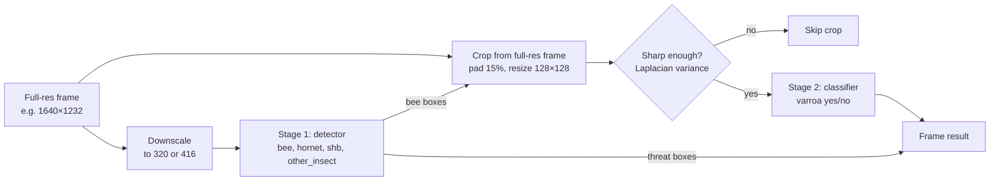

# Model architecture

Status: Implemented (v0.1 to v0.4; release v0.4). Framework chosen in [ADR-0008](../adr/0008-detector-licensing.md): YOLO11n (stage 1) and YOLO11n-cls (stage 2). Runtime: [`vision/pipeline.py`](../../vision/pipeline.py). Latency is an estimate anchored to published Raspberry Pi 3 measurements until the on-device run (Jira US11); see [results](07-results.md).

Owner: Adrien Cubilla

## Constraints

| Constraint | Value | Consequence |
|---|---|---|
| CPU | Raspberry Pi 3B: 4 × Cortex-A53 at 1.2 GHz, NEON, no NPU or usable GPU for inference | Models must be small and run on an ARM-optimized CPU runtime |
| Memory | 1 GB shared with the OS and other services | Budget about 250 MB for the vision service |
| Power | Every second of full CPU load costs about 2.3 W extra | Run the detector only when needed |
| Varroa scale | About 9 × 13 px at the capture resolution, 1 to 2 px after downscaling to detector input | Cannot be a class of a low-resolution detector |
| Licensing | OSI-approved only | Affects the detector framework choice ([ADR-0008](../adr/0008-detector-licensing.md)) |

A reference point for speed: an SSD MobileNet detector in TensorFlow Lite runs at about 1 frame per second on a Pi 3, and about 5 on a Pi 4 (several independent reports, see [references](../references.md)). That model costs about 2.3 GFLOPs per frame. Models around 1 GFLOP, run with a runtime tuned for ARM such as NCNN, should land in the 0.3 to 0.8 s range on the Pi 3B. This is the number the benchmark spike must confirm.

## Two stages



### Stage 1: object detector

Finds every insect on the board at low resolution and classifies it into four classes. A bee is still 15 to 20 px long at 320 px input, which a small detector handles; hornets are much larger.

Candidates (all can export to ONNX and then NCNN):

| Model | Input | Approx. size and cost (from each project's published tables) | License | Notes |
|---|---|---|---|---|
| YOLO11n / YOLOv8n (Ultralytics) | 320 to 416 | 2.6 to 3.2 M params; 6.5 to 8.7 GFLOPs at 640, roughly a quarter of that at 320 | AGPL-3.0 | Best tooling, fastest to iterate, the proposal's first choice |
| NanoDet-Plus-m | 320 or 416 | About 1.2 M params, about 0.9 GFLOPs at 320 | Apache-2.0 | Designed for mobile ARM CPUs, ships an NCNN demo |
| YOLOX-Nano | 416 | About 0.9 M params, about 1.1 GFLOPs | Apache-2.0 | Simple anchor-free head, mature |

Verify these figures against the current README of each project before relying on them.

Chosen: YOLO11n at 320 px, COCO-pretrained, for one training and export toolchain across both stages (ADR-0008). NanoDet-Plus stays the fallback if the on-device benchmark misses the budget.

Settings:

- Input 320 px to start; try 416 if small objects (beetles, flying bees) are missed.
- Pretrained on COCO (transfer learning), fine-tuned on synthetic data. The proposal asked to compare against training from scratch; keep that as one experiment, since with unlimited synthetic data the answer is not obvious.
- Export straight to ncnn (`vision/export.py`, through pnnx). Weights are FP32; the runtime uses fp16 storage, which halves memory traffic on the A53 without changing accuracy in a meaningful way. INT8 needs the C++ `ncnn2table`/`ncnn2int8` tools and a calibration set; it is deferred until the on-device benchmark shows it is needed.

### Stage 2: Varroa classifier on bee crops

For each bee box from stage 1, crop the corresponding region from the full-resolution frame, pad it by 15 %, resize to 128 × 128, and classify `varroa` vs `no_varroa`.

| Candidate | Cost per crop | Notes |
|---|---|---|
| MobileNetV3-Small, width 0.5 to 1.0, 128 px | A few tens of MFLOPs | ImageNet-pretrained weights available in torchvision (BSD-3) |
| Custom small CNN (4 to 6 conv blocks) | Less | Trains from scratch on synthetic crops; easiest to quantize |
| Tiny detector on the crop | More | Gives the mite's position, nice for the UI; only if the classifier's errors show it is needed |
| **YOLO11n-cls, 128 px (chosen)** | 0.13 GFLOPs, 2.8 M parameters | Same toolchain as stage 1; ImageNet-pretrained; exports to ncnn the same way |

Expected cost: on the order of 10 to 40 ms per crop on the Pi 3B. A frame with 20 bees adds up to under a second. Crops can be capped per frame (for example the 16 sharpest bees) to bound latency.

Why not a single detector at higher resolution: 1640 px input would cost about 25× a 320 px input. Why not tiling (SAHI): about 20 tiles per frame. Two stages spend high-resolution computation only where bees are.

Why classification and not mite detection in v1: the beekeeper needs to know whether returning bees carry mites and how many bees are affected, not where on each bee the mite sits. A classifier is cheaper, easier to train, and its errors are easier to analyze. Training data still records mite positions, so a mite detector can be trained later without regenerating anything.

### Blur filter

Crops of flying or fast-moving bees are skipped by stage 2: a mite is not recognizable under several pixels of motion blur, and those crops would only add false negatives and false positives. The variance of the Laplacian is a cheap sharpness measure; the threshold is set on synthetic crops with known blur and checked on tier C frames.

## From frames to events

A single frame is not a decision. Two aggregation rules turn frame results into what the backend receives.

### Threats (hornet, beetle)

An alert-worthy detection needs the class to appear in at least `k` of the last `n` analyzed frames, each above the class threshold. Defaults: `k = 3`, `n = 10` for hornets; `k = 2`, `n = 10` for beetles (rarer, and they move less). Thresholds are set per class on the validation set to reach the target recall, then checked against the false alert budget (see [evaluation](05-training-and-evaluation.md)).

### Varroa index

Over a rolling window (1 h and 24 h):

```text
varroa_index = bees classified with varroa / bees classified
```

Reported together with the number of bees classified and a 95 % Wilson confidence interval, so "3 % (95 % CI 2.1 to 4.2 %, n = 1,850)" and "8 % (95 % CI 1.4 to 35 %, n = 12)" are not confused. A bee walking in front of the camera for several frames is counted once per frame in v1; tracking to count individuals is a v2 improvement.

The index is not the colony's infestation rate. Many phoretic mites ride under the abdomen where a top-down camera cannot see them. The index tracks changes over time; the beekeeper confirms with an alcohol wash or sugar roll. Action thresholds should come from the client.

## Output contract

The vision service writes one record per analyzed frame to the local outbox and emits events. This is the format other services rely on; changing it needs Ricardo's and James's approval.

```json
{
  "schema": "smarthive.detection.frame/1",
  "frame_id": "0190f5a2-7c1e-7d43-9a1b-2f6c8e0d4b11",
  "ts": "2026-10-06T14:03:21.412Z",
  "clock_synced": true,
  "model": {"stage1": "yolo11n-320-int8@v1.0.0", "stage2": "mnv3s-128-int8@v1.0.0"},
  "image": {"w": 1640, "h": 1232, "kept": true, "image_id": "0190f5a2-7c1e-7d43-9a1b-2f6c8e0d4b12"},
  "timing_ms": {"motion": 6, "stage1": 540, "stage2": 210, "total": 790},
  "objects": [
    {"cls": "bee", "conf": 0.91, "box": [412, 230, 498, 301], "sharp": true, "varroa_p": 0.07},
    {"cls": "bee", "conf": 0.88, "box": [640, 310, 721, 380], "sharp": true, "varroa_p": 0.83},
    {"cls": "hornet", "conf": 0.76, "box": [90, 40, 260, 170]}
  ]
}
```

Boxes are `[x1, y1, x2, y2]` in full-resolution pixel coordinates. Per-frame records stay on the node (and are summarized); events and summaries go to the backend, as defined in the [messaging contract](../05-backend/04-messaging-contract.md).

## Model versioning

Every exported model has a semantic version, and its file name includes architecture, input size and precision. The node reports the versions it runs in its health messages, and every detection carries them, so any detection can be traced to the model and dataset that produced it (via MLflow).

## Server-side second opinion (later)

When the node uploads a relevant image, the server can run a larger model (for example YOLO11s at 640 px, or the same two stages at higher resolution) and either confirm or downgrade the detection before notifying. This trades a few seconds of latency for fewer false alerts. It is in the roadmap, not in Prototype 1.
