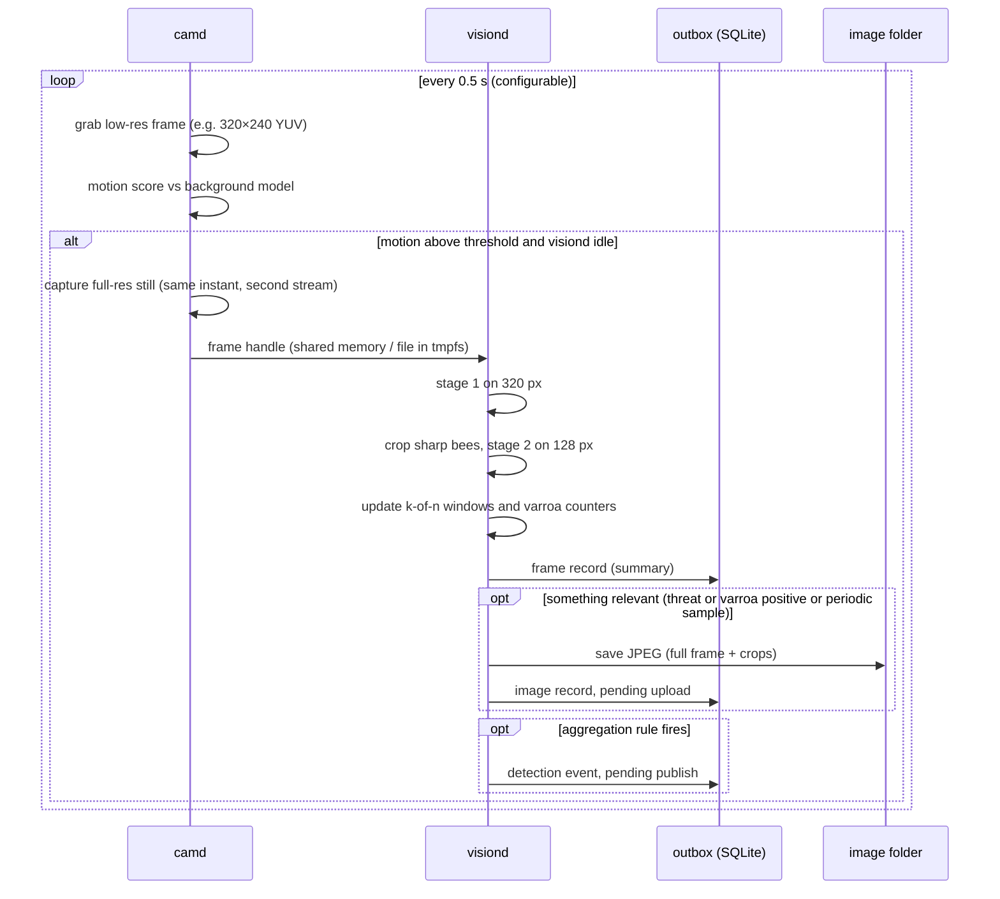
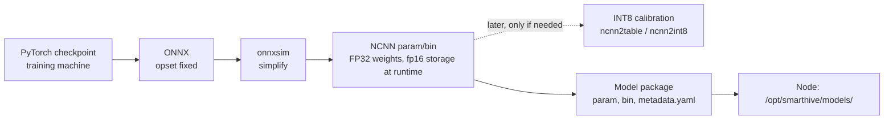

# Edge deployment

Status: Runtime implemented ([`vision/pipeline.py`](../../vision/pipeline.py), [`vision/export.py`](../../vision/export.py), [`vision/bench.py`](../../vision/bench.py)); node services and the on-device benchmark are pending the Pi (Jira US07, US11)

Owners: Adrien Cubilla (vision service), Ricardo Villarreal (OS image, camera, power)

How the vision models run on the Raspberry Pi 3B. The other services on the node (sensors, uplink, agent) are described in [edge node software](../05-backend/03-edge-node-software.md).

## Runtime pipeline

Key points:

- Two camera streams. With a CSI camera and `picamera2`, the low-resolution stream for motion and the full-resolution stream for stills come from the same sensor at the same time, with no extra resize on the CPU. With a USB camera, use V4L2 at a moderate resolution and grab stills on demand; it costs more CPU.
- Motion gating. OpenCV background subtraction (MOG2) or a running-average difference on the low-res stream. The detector runs only on frames with motion and only when it is not already busy (frames are dropped, not queued, so latency never piles up).
- Night mode. Between configured sunset and sunrise, the camera stops entirely.
- Relevant images only (US08). Full frames are kept when a threat or a Varroa-positive bee is found, plus one periodic sample per hour for the dashboard's "latest image" (US15) and for future field evaluation.
- Frames live in RAM. Candidate frames go through `tmpfs` (`/run/smarthive/frames`) so the SD card only sees the images we keep.

## Runtime and libraries on the node

| Component | Choice | License | Why |
|---|---|---|---|
| OS | Raspberry Pi OS Lite, 64-bit | Various FOSS | Headless; 64-bit gives NEON-friendly AArch64 builds |
| Camera | `picamera2` (CSI) or OpenCV V4L2 (USB) | BSD-2 / Apache-2.0 | |
| Image ops | OpenCV (headless build), NumPy | Apache-2.0 / BSD | |
| Inference | NCNN Python bindings | BSD-3 | Fastest CPU runtime on ARM in published comparisons; small footprint |
| Fallback inference | ONNX Runtime | MIT | If an operator is missing in NCNN |
| Not on the node | PyTorch, Ultralytics, TensorFlow | | Too heavy for 1 GB of RAM; used only for training and export |

## Threads: leave a core free

Measured while building the pipeline: with all four cores busy with other work, YOLO11n in ncnn took 26 ms with 1 thread and over 3,100 ms with 4 threads on the same machine. ncnn's threads synchronize at every layer, and when one of them is descheduled the others wait. Setting `openmp_blocktime = 0` (no spinning) does not fix it.

On the node, `camd`, `sensord` and `uplinkd` are light but not idle. `vision/pipeline.py` therefore defaults to 3 threads and `openmp_blocktime = 0`, leaving one core for everything else. The on-device benchmark should compare 3 and 4 threads with the full node software running before this default changes.

## Export path

`meta.json` holds the class names, input size, normalization, thresholds, model version and the dataset ID it was trained on. The vision service refuses to load a model whose metadata does not match the output contract version it implements.

## Memory budget (1 GB)

| Consumer | Budget |
|---|---|
| OS, systemd, networking, SSH | ~150 MB |
| `sensord`, `agentd`, `uplinkd` (Python) | ~120 MB together |
| `camd` (camera buffers, motion) | ~120 MB |
| `visiond` (NCNN, two models, buffers) | ≤ 250 MB |
| tmpfs for frames | 64 MB |
| GPU memory split (camera needs some) | 128 MB (`gpu_mem` in `config.txt`) |
| Free margin | the rest |

Each service has `MemoryMax=` in its systemd unit. If `visiond` exceeds it, the kernel kills it and systemd restarts it; the sensors keep running.

## Latency: estimate now, measure on the Pi

There is no Raspberry Pi in the build environment. [`vision/bench.py`](../../vision/bench.py) therefore times ncnn's own benchmark networks (squeezenet, mobilenet_v2/v3, shufflenet_v2, resnet18, mobilenet_ssd, yolov4-tiny, nanodet_m, yolo-fastestv2) on the build machine with the same thread count, divides by ncnn's published timings for a Raspberry Pi 3 Model B+ (Cortex-A53, 1.4 GHz), applies the median ratio to our models and scales 1.4 to 1.2 GHz for the 3B. It reports the min-max range across reference networks too. Run on the Pi, the same script prints real timings, which replace the estimate.

## Benchmark on the Pi (Jira US11)

With the full node software active:

| # | Measurement | Variants |
|---|---|---|
| 1 | Stage 1 latency p50/p95 | YOLO11n vs NanoDet-Plus-m; 320 vs 416; FP32 vs INT8; NCNN threads 2/3/4 |
| 2 | Stage 2 latency per crop | MobileNetV3-Small vs custom CNN; 96 vs 128 px |
| 3 | Peak RSS | Same variants |
| 4 | SoC temperature after 30 min at a busy-entrance duty cycle | In the enclosure, in the sun if possible |
| 5 | Power draw | Idle, motion only, detector running |
| 6 | Camera CPU cost | CSI dual stream vs USB |

The script lives in `vision/bench/` and writes a JSON report that is committed alongside the decision.

## Updating models on the node

Version 1: copy the model package with `rsync` over SSH and restart `visiond`; the previous package is kept for rollback. Over-the-air updates for the whole node software (REQ-14) are planned in the [roadmap](../roadmap.md) and will reuse the same package format.
