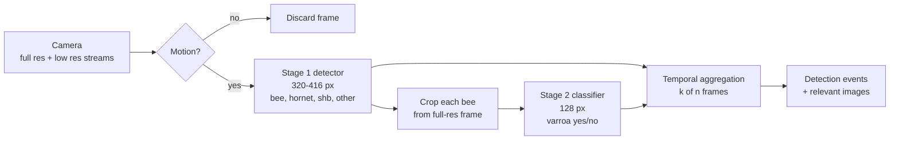

# Vision: pest and threat detection

Status: Proposed

Owner: Adrien Cubilla. Hardware side with Ricardo Villarreal.

## Summary

A camera on the node watches the landing board. A cheap motion check decides which frames are worth analyzing. On those, a small detector finds bees, hornets, small hive beetles and other insects at low resolution. Each bee is then cropped from the full-resolution frame and passed to a tiny classifier that answers one question: is there a Varroa mite on it? Detections are aggregated over several frames before anything becomes an alert, and only frames with something relevant are kept.

All of it is trained on synthetic images, because there is no client data. The synthetic images are built by pasting real, license-checked photos of insects onto real photos of our own entrance board, with physically motivated placement, lighting, blur and camera noise. Public datasets are used only to measure how well this transfers to real images.

## Reading order

| # | Document | Content |
|---|---|---|
| 1 | [Problem framing](01-problem-framing.md) | Classes, sizes, what the camera can and cannot see, output definition |
| 2 | [Camera and optics](02-camera-and-optics.md) | Resolution math, camera requirements, mounting |
| 3 | [Synthetic image pipeline](03-synthetic-image-pipeline.md) | Assets, compositor, randomization, optional 3D and diffusion routes |
| 4 | [Model architecture](04-model-architecture.md) | Two-stage design for a Pi 3B, model candidates, licenses |
| 5 | [Training and evaluation](05-training-and-evaluation.md) | Splits, metrics, sim-to-real protocol, acceptance criteria |
| 6 | [Edge deployment](06-edge-deployment.md) | Runtime pipeline, export to NCNN, benchmarks to run |

## Main decisions

| Decision | Where |
|---|---|
| Synthetic-first training data | [ADR-0002](../adr/0002-synthetic-first-training-data.md) |
| Inference on a Raspberry Pi 3B | [ADR-0003](../adr/0003-raspberry-pi-3b-edge-node.md) |
| Detector family and licensing (Ultralytics AGPL vs Apache-2.0 alternatives) | [ADR-0008](../adr/0008-detector-licensing.md) |

## Origin

This folder expands the "Pest and Threat Detection Model" proposal written for the project. The proposal's methodology (object detection, YOLOv8-nano as a first candidate, transfer learning, recall-first evaluation, domain gap analysis, edge deployment, later fusion with sensor data) is kept. What changed: the data acquisition stage is now a synthetic data pipeline, and the model is split into two stages because of the resolution problem explained in [camera and optics](02-camera-and-optics.md).
