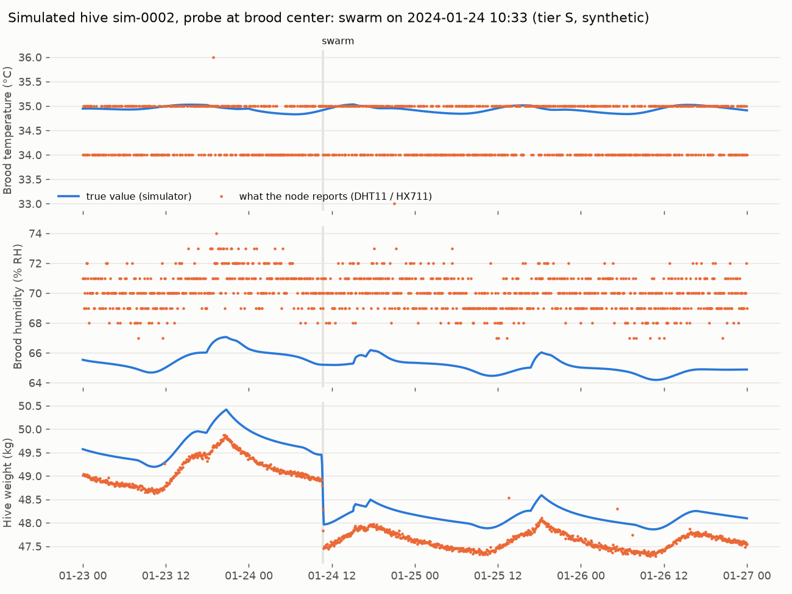
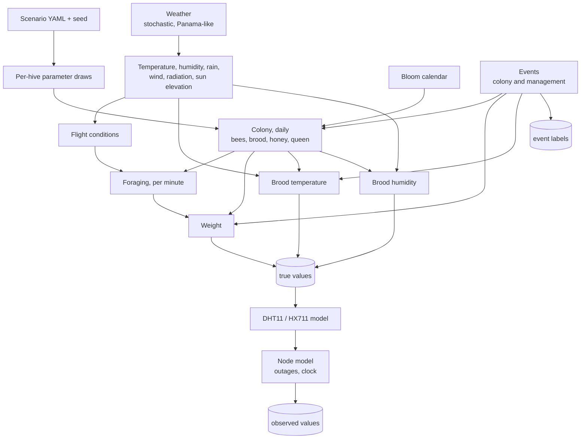

# Hive telemetry simulator

Status: Implemented (v1.0.0). Calibration against real hive data is still open (see the end of this page).

Owners: Diego Alejandro Vasquez (models), James Tack (output formats and MQTT replay)

Code: [`simulation/telemetry/sim.py`](../../simulation/telemetry/sim.py), tests in [`test_sim.py`](../../simulation/telemetry/test_sim.py), scenarios in [`scenarios/`](../../simulation/telemetry/scenarios/)

```bash
python -m simulation.telemetry.sim simulation/telemetry/scenarios/panama_baseline.yaml --seed 42
# -> data/sim/S-telemetry-panama_baseline-v1.0.0-s42/
python -m pytest simulation/telemetry/test_sim.py      # stylized facts, about 4 s
```

All six scenarios together generate in under a minute on a laptop.



*Four days of one simulated hive (tier S). Blue: the true signal. Orange: what the Prototype 1 node would report. The colony holds its brood at about 35 °C within a few tenths of a degree, and the DHT11 turns that into an integer that flips between 34 and 35. Humidity carries a fixed +5 % sensor bias. The swarm at 10:33 removes about 1.5 kg in a quarter of an hour; afterwards the daily cycle shrinks because there are fewer foragers. The weight reading drifts with the load cell's temperature.*

## What it produces

| File | Content |
|---|---|
| `telemetry.parquet` | One row per hive and output step (default 5 min, 1 min for node-realism scenarios). Columns: `ts`, `hive_id`, `temp_in`, `temp_in_true`, `temp_in_q`, `rh_in`, `rh_in_true`, `rh_in_q`, `weight`, `weight_true`, `weight_q`, `clock_offset_s`, `traffic_true` |
| `events.parquet` | Every labeled event: `hive_id`, `type`, `start`, `end`, `params` (JSON) |
| `colony_daily.parquet` | Ground truth per hive and day: adult bees `N`, brood cells `B`, honey `S_kg`, fresh nectar `P_kg`, supers, queen state, bloom |
| `weather.parquet` | The site weather actually used, at the output step |
| `manifest.json` | Generator version, git commit, seed, full config and the parameters drawn for every hive |

The columns without a suffix are what the node would report. `_true` is the model value, and `_q` is the quality flag (`ok`, `read_error`, `clipped`, `stuck`, `clock_unsynced`, and the dataset-only `no_data`, used when the node was off and the real system would have no row at all). The table is wide rather than long (one column per channel). That keeps two years of 20 hives at 5-minute steps to about 4 million rows.

Hive IDs start with `sim-`, matching the rule in the [messaging contract](../05-backend/04-messaging-contract.md) that simulated nodes can never be mistaken for real ones.

## Design principles

- Mechanistic and simple. Each signal comes from a small model of its physical cause, with parameters a person can explain at a review.
- Every uncertain parameter is a range. Each hive draws its own values, and the draws are saved in the manifest.
- Deterministic. One generator per hive, seeded from `(seed, hive index)`. Same scenario and seed, same files on any machine (checked by a test).
- Fast. The colony state steps once per day; within each day everything is vectorized over 1,440 minutes, and the slow first-order dynamics (nectar ripening, thermal lag) use `scipy.signal.lfilter`.

## Structure



## 1. Weather

The weather is generated, not downloaded. It is shared by all hives in a scenario, as they sit at the same site.

- Daily mean temperature by season (dry season December to April around 27.5 °C, rainy season around 26.5 °C) plus AR(1) day-to-day drift.
- A daily cycle with its minimum at 06:00 and maximum at 14:00, with a random amplitude (larger in the dry season).
- Wet days from a two-state Markov chain (wet days cluster), with afternoon convective showers of 20 minutes to 3 hours. Rain cools the air and saturates it, and the effect fades over about an hour.
- Humidity moves against temperature around a seasonal mean.
- Sun elevation from the coordinates, using a simple declination and hour-angle formula. Radiation follows the sun and the cloud cover.

The design originally used the Open-Meteo historical API. Open-Meteo is not reachable from the environment where the generator was built and tested, so the stochastic model is the default. Swapping in real history for the apiary's coordinates is a small change once the location is known. The generator only needs a per-minute weather frame with the same columns.

## 2. Bloom and flight

`bloom(day)` is a floor plus Gaussian bumps from the scenario. The default is a 0.15 floor (tropical forage never fully stops), a main flow centered on 10 February about 110 days wide, and a weak flow in late July. **This calendar is an assumption to confirm with the client** (EL-10, Epic 4).

Flight conditions per minute fall to zero in rain and recover slowly after it. They also drop in strong wind, below about 12 °C, in heat above 36 °C, and under heavy cloud.

## 3. Colony (daily step)

| State | Update |
|---|---|
| Laying | `lay_max × (0.3 + 0.7 × bloom)`; zero without a laying queen; reduced when stores are nearly empty |
| Brood `B` | Eggs laid over the last 21 days |
| Adult bees `N` | `+ 0.85 ×` eggs laid 21 days ago `− N/30` per day, more when starving |
| Honey `S` | Integrated from the per-minute model below, never below zero |
| Queen | `present`, `virgin` (after a swarm, mates within 10 to 16 days, 90 % success), `absent`, or `dead` colony |

`N` and `B` are interpolated across the day, so there is no step at midnight.

## 4. Foraging and weight

Bees outside at minute `t`:

```text
n_out(t) = forager_frac × N × peak_out × g(t) × flight(t) × (0.3 + 0.7 × bloom)
```

`g(t)` is a bell over daylight, starting 20 to 60 minutes after the sun rises and ending 20 to 60 minutes before it sets. Returning foragers bring nectar:

```text
intake(t) = n_out(t) / trip_min × load × bloom
P(t)      = (1 − k) P(t−1) + intake(t)                  fresh nectar, k = 1/1440 per minute
S(t)      = S(t−1) + 0.5 × k × P(t) − consumption(t)    half the nectar mass evaporates as it ripens
W(t)      = tare + supers + S + P + 0.1 g × (N − n_out) + brood + rainwater + events
```

This reproduces the pattern measured by Meikle et al. (2018) without being fitted to it. The hive gets lighter in the morning as foragers leave, heavier in the afternoon as nectar arrives, and lighter overnight as water evaporates. Rain adds water on the lid that dries over a few hours.

## 5. Brood temperature

The probe position is drawn per hive: brood center (70 %), brood edge (20 %) or super (10 %).

```text
T_target = T_set + γ_eff × (T_out − T_set) + heat_stress + γ_eff × solar
T_in     = first-order lag of T_target, τ = 30 to 90 min
γ_eff    = γ × sqrt(30,000 / N)      (a shrinking colony loses control)
```

| Parameter | Brood center | Brood edge | Super |
|---|---|---|---|
| `T_set` | 34.3 to 35.5 °C | same | same |
| `γ` | 0.01 to 0.05 | 0.10 to 0.30 | 0.30 to 0.60 |

Without brood the set point drops about 3 °C and `γ` is at least 0.4. After absconding the probe follows outside air plus solar heating of the box. An inspection lowers the target by 1 to 4 °C while the hive is open.

## 6. Brood humidity

```text
RH_target = RH_set + a × P / (P + 0.5) + b × (RH_out − RH_set)
```

`RH_set` 50 to 65 %, `a` 3 to 10 points (nectar evaporation, saturating), `b` 0.02 to 0.10 at the brood center and larger elsewhere, with a lag of 30 to 120 minutes.

## 7. Events

Colony events (swarm, absconding, queen loss, robbing) and management (inspection, super added, harvest, feeding) are described in [scenarios and events](03-scenarios-and-events.md). Management never happens on a swarm or absconding day, so each labeled event keeps a clean signature.

## 8. Sensor and node model

Described in [sensor and node realism](04-sensor-and-node-realism.md). Presets exist for DHT11 (default), SHT31 and BME280.

## 9. Stylized-fact tests

| # | Fact | Check |
|---|---|---|
| 1 | A strong, healthy colony holds the brood nest within about 34 to 36 °C | ≥ 90 % of true samples in [33.5, 36.5] °C on event-free days, strong colonies (N > 15,000) with brood and the probe at the brood center |
| 2 | Inside varies far less than outside | Median ratio of daily std (inside / outside) < 0.3 |
| 3 | Weight falls in the morning on flight days | Weight at 09:00 below 07:00 on ≥ 80 % of dry flow days |
| 4 | Afternoon gain and overnight loss during a flow | Both on ≥ 70 % of dry flow days |
| 5 | Rain costs foraging | Paired by hive, the mean 24-hour weight change on wet flow days (≥ 2 h of rain between 09:00 and 16:00) is below that on dry days |
| 6 | A swarm is a sudden daytime drop | 0.8 to 4 kg lost across the event, starting between 10:00 and 14:00 |
| 7 | After absconding the inside goes to ambient | Mean night-time difference < 2 °C between 6 and 30 hours after |
| 8 | Brood humidity is regulated | ≥ 80 % of true samples in 45 to 70 % |
| 9 | Determinism | Two runs with the same seed give identical files |
| 10 | Sensor limits respected | DHT11 output integer, temperature within 0 to 50 °C, humidity within 20 to 90 % |

The suite runs in about 4 seconds. It was checked against ten different seeds; the only failure was a sample-size guard in one seed (too few hives with both wet and dry days), which the test now handles.

Building the tests also caught real bugs in early versions of the model: nectar intake counted the bloom and flight factors twice (colonies starved), the bloom window was too narrow for a tropical dry season, management could land on top of a swarm, and humidity grew without bound during strong flows. Each fix is in the git history.

## 10. Scenarios

| Scenario | Hives × days | Purpose |
|---|---|---|
| `panama_baseline` | 20 × 730 | Normal years, default rates. General training and dashboard demos |
| `swarm_season` | 50 × 120 | Swarms oversampled during the flow |
| `abscond_and_collapse` | 30 × 180 | Absconding and queen loss oversampled: the novel anomalies held out of anomaly-detector training |
| `sensor_hell` | 10 × 90 | Very high rates of sensor and node faults |
| `quiet_hive` | 10 × 365 | No colony events: baseline for false-alarm rates |
| `battery_node` | 3 × 30, 1-minute step | Prototype 1 on battery alone, swapped daily: the gaps the power budget predicts |

Seed 42 of each takes about 340 MB of Parquet in total, stored under `data/` (not in git).

## What it does not do yet

- Calibration against a real hive. The parameter ranges come from literature and common sense. When the MSPB dataset (or our own node) provides real series, compare summary statistics (daily amplitude, autocorrelation, event signatures) and tighten the ranges.
- Real weather. See section 1.
- MQTT replay of the generated files as fake nodes. It belongs with the backend work and is planned in the [roadmap](../roadmap.md).
- A scripted `demo_day` scenario with events at fixed times. Also planned with the replay.
- Disease dynamics (Varroa load does not feed back into the colony) and acoustics.
