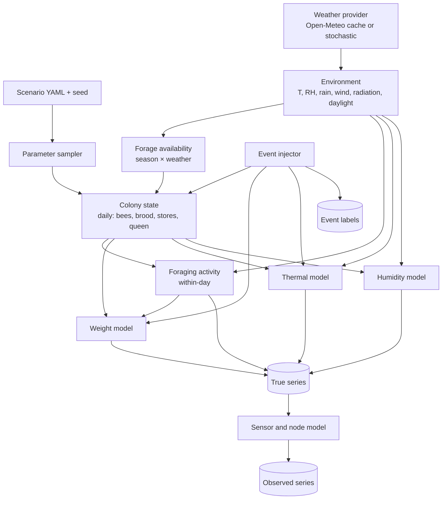

# Hive telemetry simulator

Status: Proposed

Owners: Diego Alejandro Vasquez (models), James Tack (output formats and MQTT replay)

Code: `simulation/telemetry/` (planned)

## What it produces

For each simulated hive, at a configurable time step (default 1 minute):

| Channel | Unit | In Prototype 1 hardware? |
|---|---|---|
| `temp_in` | °C | Yes (DHT11 inside the hive) |
| `rh_in` | % RH | Yes (DHT11) |
| `temp_out`, `rh_out` | °C, % RH | Optional second sensor |
| `weight` | kg | No (simulated until a load cell exists) |
| `traffic` | bees per minute through the entrance | No (could come from the camera later) |

Each channel comes in two versions: the true value from the model, and the observed value after the [sensor and node model](04-sensor-and-node-realism.md) has quantized, biased, clipped and dropped it. Alongside the series, the simulator writes a table of labeled events (swarms, harvests, sensor faults...) with exact start and end times. See [scenarios and events](03-scenarios-and-events.md).

It can write files for training (Parquet) or publish live over MQTT as fake nodes for the backend (`replay`).

## Design principles

- Mechanistic and simple. Each signal comes from a small model of the physical cause. We prefer a model with five understandable parameters over a better-looking one nobody can explain at the review.
- Real weather in, hive behavior out. The hive reacts to actual historical weather for the site, so rain days, heat waves and seasonal shifts are real.
- Every uncertain parameter is a range. The scenario file gives a distribution, each hive draws its own values, and the drawn values are saved with the output so any result can be traced back.
- Deterministic. Same scenario file and seed, same output, on any machine.

## Structure



## 1. Environment

Source: Open-Meteo historical API (ERA5 reanalysis), hourly variables `temperature_2m`, `relative_humidity_2m`, `precipitation`, `shortwave_radiation`, `wind_speed_10m`, `cloud_cover`. Responses are cached to Parquet the first time, so later runs work offline and are reproducible. Sunrise and sunset are computed from the coordinates with `astral`.

Hourly values are interpolated to the time step (cubic for temperature and humidity, step for precipitation).

For unit tests and for runs without network there is a stochastic weather fallback: a daily temperature sine wave around a seasonal mean, AR(1) noise, and a two-state Markov chain for rain. It is not meant to be realistic, only fast and dependency-free.

Default site: Panama. The coordinates go in the scenario file and must be replaced by the real apiary location once we know it.

## 2. Forage availability

`F(t)` in [0, 1] is how much nectar the landscape offers, and how much of it the bees can reach right now.

```text
F(t) = bloom(day_of_year) × flight_ok(t)
```

- `bloom(doy)` is a seasonal calendar defined in the scenario as a sum of Gaussian bumps (center, width, height). The default for Panama puts the main flow in the dry season (roughly December to April) with weak secondary flows in the rainy season. **This calendar is an assumption to confirm with the client** (it affects EL-10 and Epic 4).
- `flight_ok(t)` is the weather's effect on flight: zero at night, zero during rain above a threshold, reduced by strong wind and low radiation, reduced by extreme heat in the early afternoon.

## 3. Colony state (daily step)

A deliberately small population model, in the spirit of published colony models such as BEEHAVE (Becher et al. 2014) but with far fewer moving parts.

| State | Meaning | Daily update |
|---|---|---|
| `N` | Adult workers | Emergence from brood minus mortality; foragers die faster when foraging is heavy |
| `B` | Brood (cells) | Queen laying rate × (1 if queen present) × resource factor, minus emergence after about 21 days |
| `S` | Honey stores (kg) | Integrated from the weight model's intake and consumption terms |
| `queen` | `present`, `absent`, `virgin` | Changed only by events (swarm, queen loss, supersedure) |
| `forager_frac` | Share of `N` that forages | Rises with colony age structure and forage availability; typically 0.2 to 0.35 |

What matters for the signals is that `N` sets the size of the daily weight swing and the colony's heating power, `B > 0` turns on precise thermoregulation, and `S` drifts with the season.

Starting values are drawn per hive from the scenario (for example `N ~ Uniform(15k, 40k)`), so the dataset contains weak and strong colonies.

## 4. Foraging activity (within the day)

Following the pattern measured by Meikle et al. (2018) and modeled in [arXiv 2211.02335](https://arxiv.org/pdf/2211.02335):

- At first light, foragers start leaving. The hive gets lighter for a few hours because departures outnumber returns.
- Around midday departures and returns balance. With forage available, the hive starts gaining weight, because returning bees carry nectar and pollen.
- Towards dusk all foragers return.
- At night the hive slowly loses weight (water evaporating from nectar, consumption).

We model the number of bees outside as

```text
N_out(t) = forager_frac × N × F(t) × g(t)
```

where `g(t)` is a smooth bell over daylight hours with a randomized onset delay after sunrise and a randomized end before sunset. Traffic through the entrance is the derivative of the outbound and inbound flows plus a random component, which also feeds the image generator (busier entrance in synthetic images at busy times).

## 5. Weight

```text
W(t) = W_tare + W_supers(t) + S(t) + P(t) + m_bee × (N − N_out(t)) + W_water(t)
```

| Term | Meaning | Default range |
|---|---|---|
| `W_tare` | Empty boxes, frames, comb, lid | Drawn per hive |
| `W_supers` | Supers added or removed by events | Step changes |
| `S` | Ripe honey | From colony state |
| `P` | Fresh nectar not yet ripened | Gains from returning foragers, loses water overnight |
| `m_bee` | Mass of one worker | About 0.1 g |
| `W_water` | Rain on the lid, dew | Small, positive during and after rain, decays as it dries |

Fresh nectar dynamics:

```text
dP/dt = intake(t) − k_ripen × P
dS/dt = (1 − water_loss) × k_ripen × P − consumption(N, B, T_out)
intake(t) = returning_foragers(t) × load × F(t)
```

`water_loss` is the share of nectar mass that evaporates when it ripens into honey. Nectar is roughly half water and honey under a fifth, so this share is large, which is exactly why the hive loses weight overnight during a flow.

The parameter values for `load`, `k_ripen` and `consumption` are initial guesses in the scenario file, to be calibrated so the simulator reproduces the published daily curves (amplitude of the morning drop, rate of the afternoon gain, overnight loss). The calibration notebook and the target numbers will live in `simulation/telemetry/calibration/`. Until it is done, any weight-based result is marked "uncalibrated".

## 6. Internal temperature

The probe position matters as much as the colony. A DHT11 in the center of the brood nest sees a regulated 34 to 36 °C; one at the edge of the box or in a super sees something much closer to ambient. The scenario chooses a position, and each position maps to a coupling range.

With brood present:

```text
T_target(t) = T_set + γ × (T_out(t) − T_set) + heat_stress(t)
dT_in/dt   = (T_target − T_in) / τ
```

| Parameter | Meaning | Brood center | Brood edge | Super |
|---|---|---|---|---|
| `T_set` | Colony set point | Uniform(34.0, 35.5) °C | same | same |
| `γ` | Leak of ambient into the probe reading. Higher for weak colonies | 0.02 to 0.10 | 0.10 to 0.30 | 0.30 to 0.60 |
| `τ` | Thermal lag | 30 to 90 min | | |
| `heat_stress` | Overshoot on very hot afternoons when fanning cannot keep up | 0 to +1.5 °C above ~36 °C ambient | | |

`γ` also scales with colony strength: `γ_eff = γ × (N_ref / N)^0.5`, so a colony that shrinks starts losing control of its temperature, which is one of the earliest signs of trouble.

Without brood (queenless after the brood has emerged, or broodless periods), regulation is loose: `T_set` drops and `γ` rises.

After absconding, or if the colony dies, the probe tracks ambient through the thermal mass of the box: `γ = 1` with a lag of one to three hours, plus solar heating of the box on sunny afternoons.

## 7. Internal humidity

Bees regulate humidity in the brood nest too. Published measurements put the brood area around 50 to 60 % RH. During a strong nectar flow the evaporation of nectar pushes humidity up, mostly at night.

```text
RH_target(t) = RH_set + a × P(t)/P_ref + b × (RH_out(t) − RH_set)
dRH_in/dt    = (RH_target − RH_in) / τ_rh
```

| Parameter | Default |
|---|---|
| `RH_set` | Uniform(50, 65) % |
| `a` | Effect of fresh nectar, Uniform(5, 15) % at a reference load |
| `b` | Ambient coupling, 0.05 to 0.2 at the brood center, larger elsewhere |
| `τ_rh` | 30 to 120 min |

Values are clipped to [0, 100] before the sensor model, which clips again to the DHT11's 20 to 90 % range.

## 8. Output format

```text
data/sim/<dataset_name>/
├── manifest.json          scenario, seed, git commit, generator version, drawn parameters per hive
├── telemetry.parquet      ts, hive_id, channel, value_true, value_obs, quality
├── events.parquet         event_id, hive_id, type, start, end, severity, params (JSON)
├── colony_daily.parquet   date, hive_id, N, B, S, queen, forager_frac (ground truth for analysis)
└── weather.parquet        the environment actually used
```

`quality` uses the same codes as the real node (`ok`, `read_error`, `clipped`, `stuck`, `clock_unsynced`), so code written against simulated data works on real data.

## 9. Stylized-fact tests

Each of these is an automated test in `simulation/telemetry/tests/`. A change to the simulator that breaks one fails CI.

| # | Fact | Check |
|---|---|---|
| 1 | Healthy colony with brood, probe at brood center: internal temperature stays within about 34 to 36 °C most of the time | ≥ 90 % of true samples in [33.5, 36.5] °C over a month without events |
| 2 | Internal temperature varies much less than ambient | Daily std of `temp_in` < 0.3 × daily std of `temp_out` |
| 3 | Weight falls in the morning on flight days | Mean slope over the first 2 h of activity < 0 on ≥ 80 % of flight days |
| 4 | During a flow, the hive gains weight in the afternoon and loses some overnight | Both conditions on ≥ 70 % of flow days |
| 5 | Rainy days stop foraging | Daily net weight change on full-rain days ≤ 0 |
| 6 | A swarm is a sudden drop during daytime | Drop of 1 to 4 kg within 30 min, starting between 09:00 and 15:00 local |
| 7 | After absconding, internal temperature converges to ambient | Within 6 h, |`temp_in` − `temp_out`| < 2 °C except solar heating |
| 8 | Brood nest humidity stays mostly in 45 to 70 % | ≥ 80 % of true samples |
| 9 | Determinism | Same seed twice → identical files (checksum) |

These ranges come from the literature cited in this page and in [references](../references.md). When the MSPB dataset is downloaded, tests 1, 2 and 8 get a second check: summary statistics of simulated and real series must fall in the same ranges.

## 10. Interfaces

```bash
# Generate a dataset
smarthive-sim generate simulation/telemetry/scenarios/panama_baseline.yaml --seed 42 --out data/sim/panama_baseline_s42

# Publish 5 fake hives over MQTT, 60x faster than real time, with outages
smarthive-sim replay data/sim/panama_baseline_s42 --broker mqtts://localhost:8883 --speed 60 --node-behavior realistic
```

Scenario file sketch:

```yaml
name: panama_baseline
site: {lat: 8.98, lon: -79.52, tz: America/Panama}   # replace with the apiary location
period: {start: 2023-01-01, end: 2024-12-31}
step: 1min
weather: {provider: open-meteo, cache: data/cache/weather}
hives:
  count: 20
  colony:
    N0: {dist: uniform, low: 15000, high: 40000}
    forager_frac: {dist: uniform, low: 0.2, high: 0.35}
  probe_position: {choice: [brood_center, brood_center, brood_edge]}
bloom:
  - {center: "02-15", width_days: 45, height: 1.0}   # dry season flow (assumption)
  - {center: "07-01", width_days: 20, height: 0.3}
events: !include events/default_rates.yaml
sensor: !include sensors/dht11_hx711.yaml
node: !include nodes/pi3b_battery.yaml
```

## Libraries

Python 3.11, NumPy, pandas or Polars, SciPy (ODE integration and interpolation), Pydantic (config validation), PyYAML, PyArrow (Parquet), astral (sun times), httpx (Open-Meteo), paho-mqtt (replay). All are BSD, MIT or Apache-2.0 licensed.

## What this simulator will not do well

- Long-term colony dynamics over many seasons. We simulate one or two years and treat the colony model as a driver for the signals, not as biology to publish.
- Disease progression. Varroa load does not feed back into the telemetry in v1.
- Acoustic signals. Out of scope until there is a microphone.
- Pinpoint realism for a specific apiary. Without real data from that apiary it cannot be calibrated to it. The aim is that the real hive falls inside the range of what we simulate.
