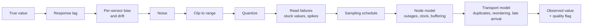

# Sensor and node realism

Status: Implemented in the simulator v1.0.0 (`observe()` in `simulation/telemetry/sim.py`), except the transport model, which belongs to the MQTT replay (planned)

Owners: Diego Alejandro Vasquez (sensor models), Ricardo Villarreal (hardware facts), James Tack (node behavior)

A model trained on clean, continuous, perfectly timed curves will be surprised by the real node. The node reports integers from a DHT11, fails some reads, goes offline when the battery runs out, boots with the wrong time, and sends the backlog in a burst, sometimes twice. This layer takes the true series from the simulator and turns it into what the backend will actually receive.

It is also how the backend team gets realistic test traffic: the same models drive the MQTT replay.

## Pipeline



Each stage is a small function with its own parameters in `simulation/telemetry/sensors/` and `simulation/telemetry/node/`. Each one can be switched off, which makes it easy to measure how much a model suffers from each imperfection.

## DHT11 model

From the datasheet and community measurements:

| Property | Value used | Notes |
|---|---|---|
| Temperature range | 0 to 50 °C | Clip |
| Temperature resolution | 1 °C | Output is an integer |
| Temperature accuracy | ±2 °C | Modeled as a fixed bias per sensor, Uniform(−2, 2), plus small noise (σ = 0.3 °C) |
| Humidity range | 20 to 90 % RH | Clip; flag `clipped` |
| Humidity resolution | 1 % RH | Integer |
| Humidity accuracy | ±5 % RH | Fixed bias per sensor, Uniform(−5, 5), plus noise (σ = 1 %) and slow drift |
| Response time | Seconds to tens of seconds | First-order lag, τ = 10 s (temperature) and 15 s (humidity) |
| Failed reads | Checksum or timeout errors | Bernoulli per read, p = 0.02 to 0.10 depending on the scenario; with the kernel driver and one retry, the effective loss is lower |
| Humidity fouling | Propolis and wax on the sensor inside the hive | Optional slow drift towards higher values over weeks |

Community reports agree that the DHT11's temperature is usable but its absolute humidity is poor, while changes in humidity are still informative. Models should therefore rely on humidity trends more than levels, and the simulator makes that the only thing that works.

### Alternatives (if a better sensor appears)

The same module has presets for SHT31 (I²C, ±0.3 °C, ±2 % RH) and BME280 (I²C, ±1 °C, ±3 % RH). Switching the preset in the scenario is enough to compare how much a better sensor would help, which is a useful argument when asking for hardware.

## HX711 and load cell model

Weight is simulated only, until the hardware exists. The model still has to be realistic, or the weight-based models will be useless the day the scale is installed.

| Effect | Model |
|---|---|
| Resolution | Quantize to 10 g (depends on cell and gain; adjust when the hardware is known) |
| Noise | Gaussian, σ = 20 to 50 g |
| Temperature sensitivity | Offset proportional to the load cell's temperature (cell shaded or in sun), `k_T` = 5 to 30 g/°C |
| Creep | Slow drift under constant load, a few tens of grams per week |
| Wind and contact | Occasional spikes of ±0.2 to 1 kg lasting a few seconds |
| Calibration error | Gain error Uniform(−2 %, +2 %) per hive |

The temperature effect matters: it creates a fake daily weight cycle that can look like foraging. A yield model must learn to see through it.

## Sampling schedule

The node samples on a timer, but not perfectly:

- Interval from the config (default 60 s for temperature and humidity, 300 s for weight).
- Jitter of a few hundred milliseconds to a few seconds.
- Missed samples when the CPU is busy with inference (rare with motion gating, more likely on busy entrances).

## Node model (Raspberry Pi 3B on battery)

| Behavior | Model | Why |
|---|---|---|
| Battery outage | The node stops entirely when simulated battery energy runs out, restarts when "charged" (scenario sets the swap or charge schedule) | Power budget gives about one day of autonomy |
| Boot time | 30 to 60 s of nothing after power returns | |
| Clock after cold boot | Starts from the last saved time (`fake-hwclock`), which is the time of shutdown. Readings carry `clock_synced = false` until NTP succeeds | The Pi has no RTC |
| NTP sync delay | 5 s to a few minutes after network is up; sometimes never during an outage | |
| Local buffer | SQLite outbox; capacity in days from the config | Store-and-forward (US03) |
| Buffer overflow | Oldest unsent readings are dropped after the retention limit | Must be visible as a gap, not as silent loss |
| Thermal throttling | On hot afternoons with heavy detector use, inference slows and some samples slip | Tropical climate, closed enclosure |

## Transport model (MQTT QoS 1), planned with the replay

| Behavior | Model | Why the backend cares |
|---|---|---|
| Duplicates | A message is delivered twice with probability p (higher right after reconnection) | QoS 1 is at-least-once. The ingestor must deduplicate by `msg_id` |
| Late arrival | After an outage the backlog arrives in batches, oldest first | Charts and rules must handle data that arrives hours late |
| Reordering | Batches from the backlog interleave with live messages | Do not assume messages arrive in timestamp order |
| Loss | Only if the outage outlasts the buffer | |

## Quality flags

Every observed sample carries one flag. The real node uses the same set.

| Flag | Meaning |
|---|---|
| `ok` | Normal reading |
| `read_error` | Sensor read failed; value is null |
| `clipped` | True value outside the sensor range; value is the limit |
| `stuck` | Value identical for longer than the configured window (set by the node's own check) |
| `clock_unsynced` | Timestamp taken before the clock was synchronized |
| `interpolated` | Never produced by the node; reserved for backend-derived series |

## Configuration

The sensor and node blocks of a scenario (defaults in `DEFAULTS` in `sim.py`):

```yaml
sensor:
  model: dht11              # dht11 | sht31 | bme280 (range, resolution, max bias, noise from the datasheets)
  read_fail_p: 0.04         # one failed DHT11 read loses temperature and humidity together
  stuck_per_year: 2
  dropout_per_week: 1.0
  hx711: {res_g: 10, noise_g: 30, temp_coeff_g_per_c: [5, 30], gain_err: 0.02, creep_g_per_week: [0, 40], spike_per_day: 0.5}
node:
  power: mains              # mains: random outages; battery: energy model, swapped daily at swap_hour
  outage_per_week: 0.5
  outage_median_h: 3
  battery_wh: [47, 66]
  draw_w: {day: 3.5, night: 1.8}
  swap_hour: 9
  ntp_slow_p: 0.1           # share of boots where NTP takes 5 to 60 minutes
```

Planned: `ideal` presets that switch every imperfection off, to measure how much each one costs a model, and the transport model (duplicates, late batches) in the MQTT replay.
