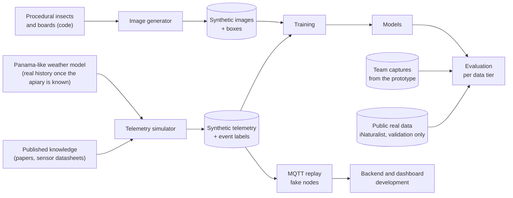

# Data

Status: Implemented: telemetry simulator v1.0.0, image generator v0.1, real check set P-inat-v1

Owners: Diego Alejandro Vasquez (telemetry), Adrien Cubilla (images), James Tack (formats and replay)

## Summary

The client will not provide data. There are no historical weights, harvests, labeled audio or entrance images to train on, and there will not be. This folder describes how we generate the data instead, and how we avoid fooling ourselves with it.

The approach in one paragraph: we write simulators that produce hive telemetry and entrance images together with perfect labels. The images are drawn entirely by code (procedural insects and boards), so they carry no third-party license. The simulators are built from published knowledge about how hives behave and from the measured limits of our own sensors, and they deliberately randomize everything we are unsure about. Models train on this synthetic data. Public datasets and our own captures are used to check whether those models work on real inputs, and they are kept separate from training. Every reported number says which kind of data it came from.

## Reading order

| # | Document | Read it if you... |
|---|---|---|
| 1 | [Data problem and strategy](01-data-problem-and-strategy.md) | want to know why and how, at the level of the whole project |
| 2 | [Hive telemetry simulator](02-hive-telemetry-simulator.md) | work on anomaly detection, yield, the backend or the dashboard |
| 3 | [Scenarios and events](03-scenarios-and-events.md) | need labeled swarms, harvests, failures to train or test against |
| 4 | [Sensor and node realism](04-sensor-and-node-realism.md) | care about the gap between a perfect signal and what a DHT11 on a Pi reports |
| 5 | [Dataset versioning and governance](05-dataset-versioning-and-governance.md) | create, store, share or cite a dataset |

The image side of the strategy is in the vision folder, because it is tightly coupled to the camera and the model: [camera and optics](../03-vision/02-camera-and-optics.md) and [synthetic image pipeline](../03-vision/03-synthetic-image-pipeline.md).
