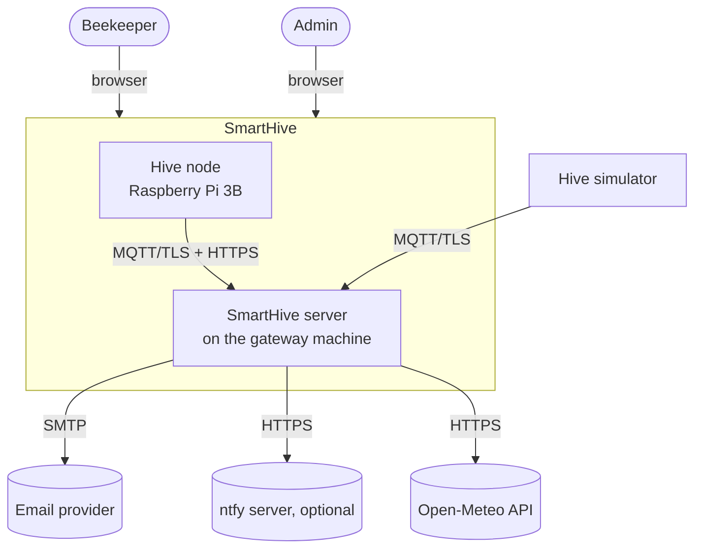
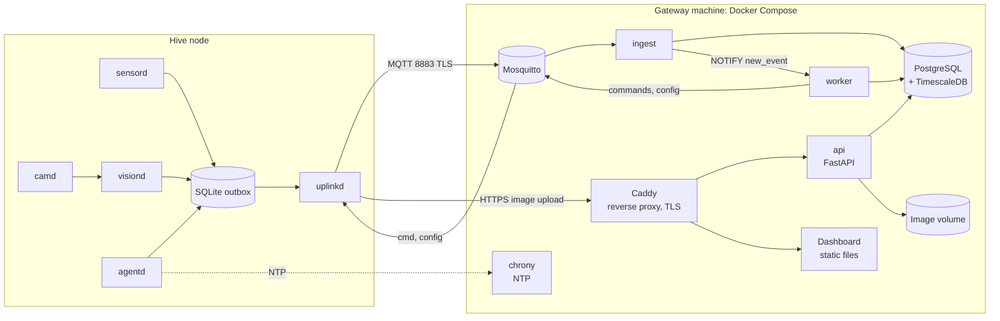
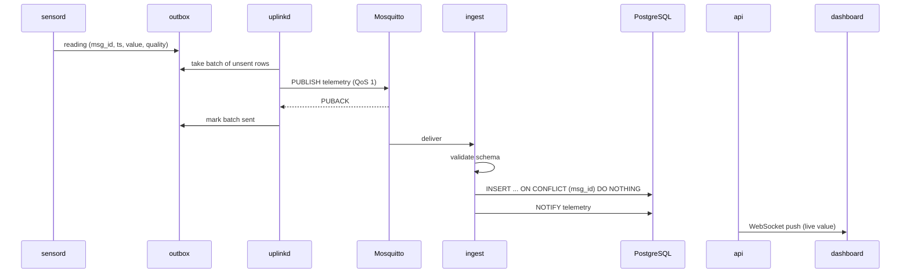
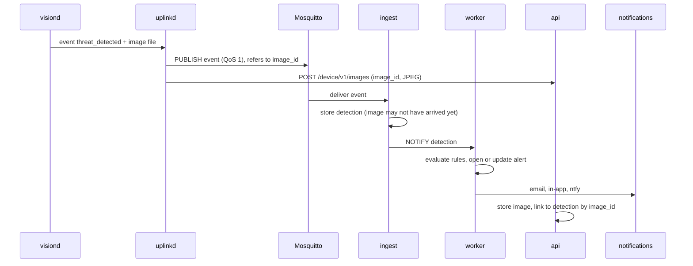

# Architecture overview

Status: Proposed

Owner: James Tack

## Constraints that shape the design

| Constraint | Source | Effect on the backend |
|---|---|---|
| One node, maybe a handful, for a demonstrator | Scope | No need for horizontal scaling, Kubernetes or a message queue cluster |
| Node is a Raspberry Pi 3B with 1 GB of RAM | [Electrical design](../02-hardware/electrical-design-prototype-1.md) | Images are analyzed on the node; the server receives results, not video |
| Ethernet to a local gateway (router or PC) for Prototype 1; LoRaWAN or cellular maybe later | Design document, presentation | The contract must not depend on Ethernet. Messages must be small enough for a constrained link later |
| Battery autonomy about one day, no RTC | [Power budget](../02-hardware/power-budget.md), [review notes](../02-hardware/hardware-review-notes.md) | Gaps of hours are normal. Data arrives late, in bursts, sometimes twice, sometimes with bad timestamps |
| No budget | Course | Self-hosted on a machine the team already has. Only FOSS. No paid cloud |
| Six students, one semester, three of whom are not backend developers | Team | Few moving parts, one language on the server, boring technology |
| No client data | [Data strategy](../04-data/01-data-problem-and-strategy.md) | The simulator is a first-class client of the backend |

## Quality goals, in priority order

1. No silent data loss. Anything the node measured and stored eventually reaches the database exactly once, or the gap is visible.
2. Contract stability. Node, simulator, backend and dashboard are built in parallel by different people. Contracts are explicit, versioned and tested.
3. Simplicity. Someone new to the project can run the whole stack with one command and understand it in an afternoon.
4. Timeliness. A detection reaches the dashboard and the alert channels within seconds on a working link (EL-22 working assumption: under 10 s).
5. Security appropriate to a demonstrator. Encrypted transport, authenticated devices and users, nothing exposed that does not need to be.

## Context

## Containers

| Container | Responsibility | Talks to |
|---|---|---|
| Mosquitto | MQTT broker. TLS, per-device credentials, topic ACLs, last will messages | Nodes, simulator, ingest, worker |
| `ingest` | Subscribes to node topics; validates payloads against JSON Schemas; writes telemetry, detections, status; deduplicates by `msg_id`; notifies the worker | Mosquitto, PostgreSQL |
| `api` | REST and WebSocket for the dashboard; device endpoint for image upload; exports; authentication | PostgreSQL, image volume |
| `worker` | Rules engine, alert lifecycle, notifications, node-offline detection, scheduled jobs (retention, ML jobs, weather fetch), commands to nodes | PostgreSQL, Mosquitto, SMTP, ntfy, Open-Meteo |
| PostgreSQL + TimescaleDB | All persistent data except image files | |
| Image volume | JPEG files, content-addressed paths | |
| Caddy | HTTPS termination, serves the dashboard, proxies `/api` and `/ws` | |
| chrony | NTP server for the node (no RTC on the Pi) | |

`ingest`, `api` and `worker` are three entry points of the same Python package and the same Docker image. See [ADR-0006](../adr/0006-python-modular-monolith.md).

## Main flows

### Telemetry

The outbox marks rows as sent only after the broker's PUBACK. If the node loses power between publish and PUBACK, the batch is sent again on restart. That duplicate is expected and the ingestor drops it by `msg_id`.

### Detection, image and alert

The event and the image travel separately and can arrive in any order. Both carry the same `image_id`, and whichever arrives second completes the link. An alert never waits for the image.

### Node goes silent (US06)

The node connects with a last will message on its `status` topic. If it disappears without disconnecting cleanly (power loss, cable pulled), the broker publishes `offline`. The worker also runs a heartbeat timeout as a second check, since a half-open TCP connection can take a while to be noticed. When a voltage sensor exists, the last health messages before silence tell the worker whether to say "probably battery" or "probably network".

## Why this shape

- MQTT for everything small, HTTPS for images. MQTT handles flaky links, retained status, last will and server-to-node commands well. It is a poor fit for images of hundreds of kilobytes on a broker that also carries telemetry. Over LoRaWAN, images could not be sent at all; only events would. Splitting them now means the link can change later without redesign. See [ADR-0004](../adr/0004-mqtt-as-integration-contract.md).
- A single database. Users, hives and alerts are relational. Telemetry is time series. PostgreSQL with TimescaleDB handles both, so there is one thing to back up, one query language, and joins between readings and hive metadata are trivial. Our volume (a few million rows a year per hive at one reading per minute per channel) is small for plain PostgreSQL. See [ADR-0005](../adr/0005-postgresql-timescaledb-apache.md).
- No separate message queue. PostgreSQL `LISTEN/NOTIFY` and MQTT itself cover the eventing we need between three processes. Adding Redis or Valkey would be one more service to run for no benefit at this scale.
- A modular monolith. Three processes, one codebase. Shared models and contracts, one test suite, one image. If one part needs to scale or split later, the module boundaries are already there.
- Edge inference. It is a requirement (FR-05, US11), and it makes the server cheap: no GPU, no video storage.

## Path to more nodes or a different link

| Change | What stays | What changes |
|---|---|---|
| 10 to 50 nodes | Everything | Maybe enable TimescaleDB compression (licensing note in ADR-0005), tune retention |
| LoRaWAN sensor nodes (ESP32) | Topics, payload semantics, database, API | Add ChirpStack (MIT) as LoRaWAN network server and a small bridge from its MQTT integration to our topics; compact binary encoding (CBOR) on the radio side |
| Cellular instead of Ethernet | Everything | Broker exposed on a public address with TLS, or a VPN (WireGuard) between node and server |
| Cloud hosting | Everything | Same Compose file on a VM |
