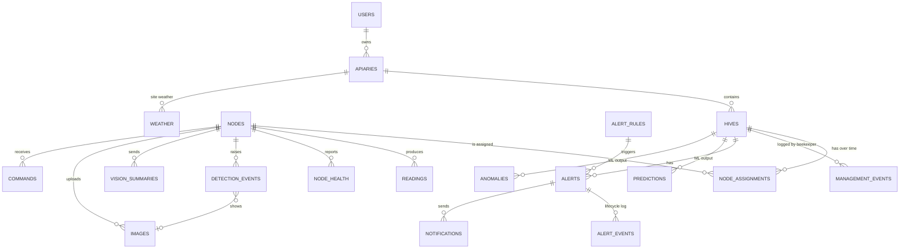

# Data model

Status: Proposed

Owner: James Tack

PostgreSQL 16+ with the TimescaleDB extension (Apache-2.0 features only). Migrations with Alembic. Times are `timestamptz`, stored in UTC; the dashboard converts to the hive's time zone.

## Entities



## Core tables

```sql
CREATE EXTENSION IF NOT EXISTS timescaledb;
CREATE EXTENSION IF NOT EXISTS citext;      -- users.email
CREATE EXTENSION IF NOT EXISTS btree_gist;  -- the EXCLUDE constraint on node_assignments (text + range)

CREATE TABLE users (
  id            uuid PRIMARY KEY,
  email         citext UNIQUE NOT NULL,
  display_name  text NOT NULL,
  password_hash text NOT NULL,                 -- argon2id
  role          text NOT NULL CHECK (role IN ('beekeeper', 'admin')),
  notify_email  boolean NOT NULL DEFAULT true,
  ntfy_topic    text,
  created_at    timestamptz NOT NULL DEFAULT now()
);

CREATE TABLE refresh_tokens (                  -- migration 0003: sessions of the API
  id          uuid PRIMARY KEY,
  user_id     uuid NOT NULL REFERENCES users(id) ON DELETE CASCADE,
  token_hash  text NOT NULL UNIQUE,            -- SHA-256 of the cookie value; the token itself is never stored
  created_at  timestamptz NOT NULL DEFAULT now(),
  expires_at  timestamptz NOT NULL,
  revoked_at  timestamptz,
  replaced_by uuid                             -- the token that took over when this one was rotated
);

CREATE TABLE apiaries (
  id        uuid PRIMARY KEY,
  owner_id  uuid NOT NULL REFERENCES users(id),
  name      text NOT NULL,
  lat       double precision,
  lon       double precision,
  timezone  text NOT NULL DEFAULT 'America/Panama'
);

CREATE TABLE hives (
  id           uuid PRIMARY KEY,
  apiary_id    uuid NOT NULL REFERENCES apiaries(id),
  name         text NOT NULL,
  hive_type    text,                           -- langstroth, top-bar...
  boxes        smallint,
  installed_on date,
  notes        text,
  archived     boolean NOT NULL DEFAULT false
);

CREATE TABLE nodes (
  id            text PRIMARY KEY,              -- node-0001, sim-0042
  is_simulated  boolean NOT NULL,              -- true for sim- nodes; never mixed in reports
  device_token_hash text,                      -- only nodes that upload images over HTTP have one; NULL until issued
  hardware      jsonb NOT NULL DEFAULT '{}',   -- board, sensors, camera
  registered_at timestamptz NOT NULL DEFAULT now(),
  last_seen_at  timestamptz,
  status        text NOT NULL DEFAULT 'unknown'  -- online | offline | unknown
);

CREATE TABLE node_assignments (
  node_id   text NOT NULL REFERENCES nodes(id),
  hive_id   uuid NOT NULL REFERENCES hives(id),
  valid     tstzrange NOT NULL,
  EXCLUDE USING gist (node_id WITH =, valid WITH &&)   -- a node is on one hive at a time
);
```

## Time series

```sql
CREATE TABLE readings (
  ts            timestamptz NOT NULL,
  node_id       text NOT NULL,
  hive_id       uuid,                          -- resolved from node_assignments at ingestion
  quantity      text NOT NULL,                 -- temp_in, rh_in, weight...
  value         double precision,              -- NULL when quality = read_error
  quality       text NOT NULL,
  sensor        text NOT NULL,
  clock_synced  boolean NOT NULL,
  msg_id        uuid NOT NULL,
  idx           smallint NOT NULL,             -- position in the batch
  received_at   timestamptz NOT NULL DEFAULT now(),
  PRIMARY KEY (msg_id, idx, ts)                -- ts must be in the key of a hypertable
);
SELECT create_hypertable('readings', 'ts', chunk_time_interval => interval '7 days');
CREATE INDEX ON readings (hive_id, quantity, ts DESC);

CREATE TABLE node_health (
  ts       timestamptz NOT NULL,
  node_id  text NOT NULL,
  data     jsonb NOT NULL,                     -- the health payload as received
  PRIMARY KEY (node_id, ts)
);
SELECT create_hypertable('node_health', 'ts', chunk_time_interval => interval '7 days');

CREATE TABLE weather (
  ts         timestamptz NOT NULL,
  apiary_id  uuid NOT NULL REFERENCES apiaries(id),
  temp_c double precision, rh_pct double precision, precip_mm double precision,
  wind_ms double precision, radiation_wm2 double precision,
  source     text NOT NULL,                    -- open-meteo-archive | open-meteo-forecast
  PRIMARY KEY (apiary_id, ts, source)
);
```

**Why a narrow (long) table** for readings, one row per value, instead of one column per sensor: Prototype 1 has two quantities, the backlog has at least five more (weight, outside temperature and humidity, battery voltage and current), and the simulator has a few others. A narrow table takes new quantities without migrations. The cost is more rows, which is irrelevant at our volume: one hive with five quantities at one reading per minute is about 2.6 million rows a year.

**Deduplication** is the primary key: `INSERT ... ON CONFLICT DO NOTHING`. A batch delivered twice inserts nothing the second time.

**Nodes register themselves.** The first accepted message from a node creates its `nodes` row (`is_simulated` from the `sim-` prefix of the id). The device token is issued later through the API. `status` is `unknown` until a `status` or `health` message arrives; `last_seen_at` is the arrival time of the latest message.

**Unknown hive:** if a node sends data while not assigned to any hive, `hive_id` is NULL. The rows are kept and backfilled when the node gets assigned, so setting up a node in the field before registering it in the dashboard loses nothing.

Downsampling for charts is done at query time with `time_bucket()` (Apache-2.0). At our volume a 30-day chart aggregates under 50,000 rows, which PostgreSQL handles in milliseconds. Continuous aggregates would be the usual tool at larger scale but are under the Timescale License; see [ADR-0005](../adr/0005-postgresql-timescaledb-apache.md).

## Vision

```sql
CREATE TABLE images (
  id           uuid PRIMARY KEY,               -- image_id from the node
  node_id      text NOT NULL REFERENCES nodes(id),
  hive_id      uuid,
  captured_at  timestamptz NOT NULL,
  clock_synced boolean NOT NULL,
  reason       text NOT NULL,                  -- threat | varroa | periodic | on_demand
  path         text NOT NULL,                  -- relative to the image volume
  sha256       text NOT NULL,
  bytes        integer NOT NULL,
  width        integer, height integer,
  objects      jsonb NOT NULL DEFAULT '[]',
  received_at  timestamptz NOT NULL DEFAULT now(),
  expires_at   timestamptz                     -- retention
);

CREATE TABLE detection_events (
  msg_id       uuid PRIMARY KEY,
  episode_id   uuid NOT NULL,
  node_id      text NOT NULL REFERENCES nodes(id),
  hive_id      uuid,
  type         text NOT NULL,                  -- threat_detected | varroa_high | sensor_fault...
  cls          text,
  first_seen   timestamptz NOT NULL,
  last_seen    timestamptz NOT NULL,
  max_conf     real,
  frames_positive smallint, frames_window smallint,
  image_id     uuid,                           -- may reference an image not yet received
  models       jsonb,
  received_at  timestamptz NOT NULL DEFAULT now()
);
CREATE INDEX ON detection_events (hive_id, first_seen DESC);

CREATE TABLE vision_summaries (
  node_id      text NOT NULL,
  hive_id      uuid,
  window_start timestamptz NOT NULL,
  window_end   timestamptz NOT NULL,
  frames_analyzed integer NOT NULL,
  counts       jsonb NOT NULL,
  varroa_classified integer NOT NULL,
  varroa_positive   integer NOT NULL,
  msg_id       uuid NOT NULL UNIQUE,
  PRIMARY KEY (node_id, window_start)
);
```

`detection_events.image_id` has no foreign key on purpose: the event and the image arrive independently, in either order.

## Alerts

```sql
CREATE TABLE alert_rules (
  id         text PRIMARY KEY,                 -- predefined: hornet_detected, node_offline...
  enabled    boolean NOT NULL DEFAULT true,
  severity   text NOT NULL CHECK (severity IN ('info', 'warning', 'critical')),
  params     jsonb NOT NULL DEFAULT '{}',      -- thresholds the user may adjust (EL-19)
  hive_id    uuid REFERENCES hives(id)         -- NULL = default for all hives
);

CREATE TABLE alerts (
  id          uuid PRIMARY KEY,
  hive_id     uuid REFERENCES hives(id),
  node_id     text REFERENCES nodes(id),
  rule_id     text NOT NULL,
  severity    text NOT NULL,
  state       text NOT NULL CHECK (state IN ('open', 'acknowledged', 'resolved')),
  title       text NOT NULL,
  details     jsonb NOT NULL,
  dedup_key   text NOT NULL,                   -- e.g. rule + hive + episode; one open alert per key
  opened_at   timestamptz NOT NULL,
  last_seen_at timestamptz NOT NULL,
  acknowledged_at timestamptz, acknowledged_by uuid REFERENCES users(id),
  resolved_at timestamptz, resolved_by uuid REFERENCES users(id),
  resolution_note text
);
CREATE UNIQUE INDEX one_open_alert_per_key ON alerts (dedup_key) WHERE state <> 'resolved';

CREATE TABLE alert_events (                    -- audit trail for US14
  id        bigserial PRIMARY KEY,
  alert_id  uuid NOT NULL REFERENCES alerts(id),
  at        timestamptz NOT NULL DEFAULT now(),
  kind      text NOT NULL,                     -- opened | updated | acknowledged | resolved | notified | note
  actor     uuid REFERENCES users(id),         -- NULL = system
  data      jsonb NOT NULL DEFAULT '{}'
);

CREATE TABLE notifications (
  id        bigserial PRIMARY KEY,
  alert_id  uuid NOT NULL REFERENCES alerts(id),
  user_id   uuid NOT NULL REFERENCES users(id),
  channel   text NOT NULL,                     -- in_app | email | ntfy
  status    text NOT NULL,                     -- pending | sent | failed
  attempts  smallint NOT NULL DEFAULT 0,
  sent_at   timestamptz, error text,
  read_at   timestamptz                        -- in-app read receipt
);
```

## Beekeeper log, ML output, commands

```sql
CREATE TABLE management_events (               -- inspections, supers, harvests, treatments
  id        uuid PRIMARY KEY,
  hive_id   uuid NOT NULL REFERENCES hives(id),
  type      text NOT NULL,
  started_at timestamptz NOT NULL,
  ended_at   timestamptz,
  data      jsonb NOT NULL DEFAULT '{}',       -- e.g. {"harvest_kg": 8.5}
  created_by uuid REFERENCES users(id)
);

CREATE TABLE anomalies (
  id        uuid PRIMARY KEY,
  hive_id   uuid NOT NULL REFERENCES hives(id),
  period    tstzrange NOT NULL,                -- "window" is a reserved word in PostgreSQL
  score     real NOT NULL,
  kind      text,                              -- NULL = unknown pattern (US16)
  model     text NOT NULL,
  created_at timestamptz NOT NULL DEFAULT now()
);

CREATE TABLE predictions (
  hive_id   uuid NOT NULL REFERENCES hives(id),
  made_at   timestamptz NOT NULL,
  target    text NOT NULL,                     -- yield_7d_kg
  horizon   interval NOT NULL,
  p10 real, p50 real, p90 real,                -- range, as US19 asks
  model     text NOT NULL,
  PRIMARY KEY (hive_id, target, made_at)
);

CREATE TABLE commands (
  id         uuid PRIMARY KEY,
  node_id    text NOT NULL REFERENCES nodes(id),
  name       text NOT NULL,
  args       jsonb NOT NULL DEFAULT '{}',
  issued_by  uuid REFERENCES users(id),
  issued_at  timestamptz NOT NULL DEFAULT now(),
  expires_at timestamptz NOT NULL,
  result     text, detail text, acked_at timestamptz
);
```

`management_events` matters more than it looks. When the beekeeper logs "inspection 10:00 to 10:20", the anomaly job and the rules ignore the weight and temperature disturbance in that window, and the yield model can subtract harvests. Without it, every inspection looks like an anomaly.

### Who writes what

| Table | Written by | Read by |
|---|---|---|
| `management_events` | The beekeeper, through `POST /hives/{id}/management-events` | Alert rules, ML features, the dashboard |
| `anomalies` | ML jobs, with `smarthive.jobs.write_anomaly` | `GET /hives/{id}/anomalies` |
| `predictions` | ML jobs, with `smarthive.jobs.write_prediction` | `GET /hives/{id}/predictions` |

A job reads its input with `smarthive.jobs.read_features`, which returns bucketed readings of quality `ok` and leaves out everything taken during a logged event or in the 30 minutes after it. Every row a job writes carries the model name; the functions refuse an empty one. Units: weights in kilograms, temperatures in degrees Celsius, `horizon` as an interval, `p10 <= p50 <= p90`. The columns are the ones above; Diego should confirm them before the first model writes (SCRUM-88, criterion 4).

## Retention

Run by the worker every night:

| Data | Kept | Working assumption for EL-09 |
|---|---|---|
| `readings`, `vision_summaries`, `detection_events`, `alerts` and their logs | Indefinitely | Small |
| `node_health` | 90 days | Debugging only |
| Images with `reason` threat or varroa | 1 year | |
| Images with `reason` periodic or on_demand | 30 days | |

Old chunks of hypertables are removed with `drop_chunks()`, which is available in the Apache-2.0 edition; only the automatic retention *policy* is TSL-licensed, so we call it from our own scheduler instead.

## Simulated data

Rows from simulated nodes live in the same tables, distinguished by `nodes.is_simulated`. All API queries and exports filter them out unless explicitly requested, and the dashboard marks simulated hives with a visible badge. Reports must never mix them.
