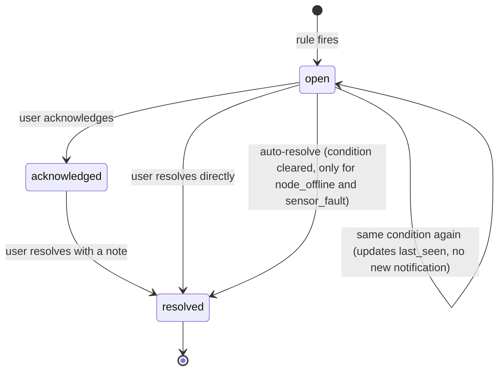

# Alerts and rules

Status: Proposed. The catalog is the working answer to EL-17 until the client responds.

Owners: James Tack (engine), Maria de los Angeles Agudelo (UI)

## Severity

| Severity | Meaning | Notification |
|---|---|---|
| `critical` | Something is attacking or leaving the colony right now. Act today | In-app + email (+ ntfy if configured) |
| `warning` | Something looks wrong. Check when convenient (US17) | In-app only |
| `info` | Worth knowing, no action needed | Dashboard only |

## Catalog

| Rule ID | Trigger | Default severity | Default parameters | Story |
|---|---|---|---|---|
| `hornet_detected` | `threat_detected` event, class `hornet` | critical | node-side k-of-n, see vision docs | US10, US12 |
| `shb_detected` | `threat_detected` event, class `shb` | warning | | US10 |
| `varroa_high` | Varroa index over the last 24 h above threshold with enough bees counted | warning | threshold 3 %, min 300 bees | US09 |
| `varroa_rising` | 7-day trend of the daily index significantly positive | warning | | US09 |
| `node_offline` | Last will received, or no message for N × heartbeat | warning (critical after 24 h) | N = 5 | US06 |
| `node_power_low` | Battery voltage below threshold, or under-voltage flag set repeatedly | warning | 3S pack: 10.2 V | US06 |
| `temp_out_of_range` | Brood temperature outside range for longer than a duration | warning | 32 to 37 °C for 2 h | US01 |
| `rh_out_of_range` | Humidity outside range for longer than a duration | info | 40 to 85 % for 6 h | US01 |
| `weight_sudden_drop` | Weight drops more than X kg in Y minutes, outside a logged management event | critical | 1 kg in 30 min | Swarm / absconding |
| `sensor_fault` | `sensor_fault` event or no valid reading for a quantity for M minutes while the node is online | warning | M = 15 | EL-08 |
| `clock_unsynced` | Node reporting unsynced clock for more than an hour | info | | |
| `anomaly_detected` | ML anomaly score above threshold, unknown pattern | warning | | US16, US17 |
| `harvest_ready`, `add_super` | Recommendation from the yield model | info | | US21, US22 (EL-11: informative) |

Rules marked with a weight trigger need the load cell, so they are active only with simulated nodes until then. They are still worth building now: the simulator produces swarms, and the demo can show the full chain.

## Lifecycle

- One open alert per `dedup_key` (for example `hornet_detected:<hive>:<episode>`). Repeated triggers update the existing alert instead of spamming.
- Every transition writes an `alert_events` row with the actor and time, which is the "response log" in US14.
- Only `node_offline` and `sensor_fault` resolve themselves when the condition clears. A hornet that left is still a hornet the beekeeper should know about.

## Notifications

| Channel | How | Notes |
|---|---|---|
| In-app | `notifications` row + WebSocket push | Always on |
| Email | SMTP from the worker, Jinja2 templates, includes the image thumbnail for detections | Any existing SMTP account; Mailpit in development |
| ntfy | HTTP POST to a self-hosted ntfy server, topic per user | Optional phone push without vendor accounts |
| SMS | Not planned | Costs money; EL-18 |

Delivery runs from the `notifications` table with retries, so a mail server outage delays notifications instead of losing them. A per-user rate limit (for example at most one email per rule per hive per 30 minutes) protects against floods.

## Suppression

- During a logged management event (inspection, harvest), weight and temperature rules are suppressed for that hive, plus a margin.
- During the first hour after a node reconnects with backlog, rules evaluate backlog data but mark the alert as "late" and do not send critical notifications for events older than a configurable age (default 6 h). The beekeeper still sees them in the dashboard.
- Simulated nodes never send email or ntfy notifications unless the demo profile enables it explicitly.

## Engine

The worker evaluates two kinds of rules:

- Event rules react to a single message (a detection event, a last will). They run on `NOTIFY` from the ingestor, within a second.
- Window rules look at a time range (temperature out of range for 2 h, weight drop in 30 min, offline for N heartbeats). They run every minute over the latest data per hive, using SQL with `time_bucket`.

Rules are Python functions registered with an ID, a severity and a parameter schema. Parameters live in `alert_rules` so users can adjust thresholds (EL-19 working assumption) without new rule types. Each rule has unit tests against simulator scenarios with known events (see [scenarios](../04-data/03-scenarios-and-events.md#for-the-backend-and-the-dashboard)).

## Implementation status

`smarthive worker` runs the engine (`backend/src/smarthive/alerts/`). It evaluates every enabled rule once at start, again on each `NOTIFY` from the ingestor, and at least every `SMARTHIVE_ALERT_INTERVAL_S` seconds (default 60).

Built: `hornet_detected`, `shb_detected`, `varroa_high`, `node_offline`, `temp_out_of_range`, `rh_out_of_range`, the lifecycle with its event log, in-app notification rows, and the API (`/alerts`, `/alert-rules`). Default thresholds are seeded by migration 0004.

Differences from the design above:

- A condition a user resolved by hand does not reopen for 6 hours, so a standing window condition does not alert again a minute later.
- Detection alerts are one per episode and never reopen. Window alerts are one per hive (or node).
- Email and ntfy notifications are written as `pending` rows. Nothing sends them yet.
- `node_offline` stays `warning`; the escalation to `critical` after 24 hours is not built.
- Not built yet: `varroa_rising`, `node_power_low`, `weight_sudden_drop`, `sensor_fault`, `clock_unsynced`, `anomaly_detected`, the recommendation rules, and the late-data suppression after a reconnect. Weight and temperature rules do skip hives with a running management event.
