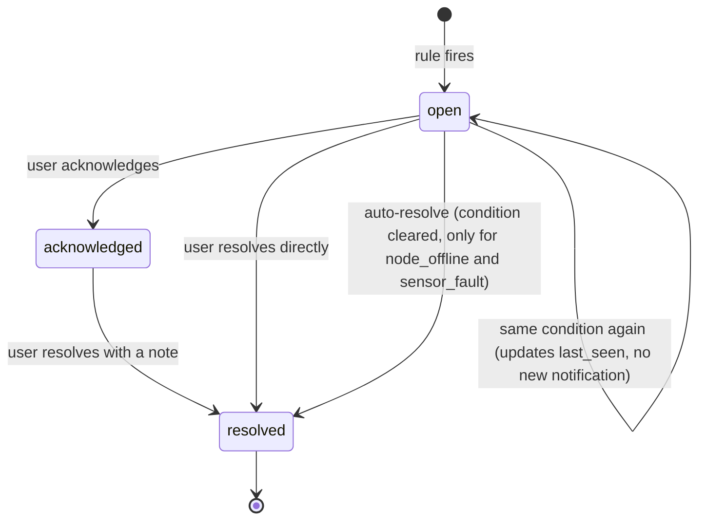

# Alerts and rules

Status: Proposed. The catalog is the working answer to EL-17 until the client responds.

Owners: James Tack (engine), Maria de los Angeles Agudelo (UI)

## Severity

| Severity | Meaning | Notification |
|---|---|---|
| `critical` | Something is attacking or leaving the colony right now. Act today | In-app + email (+ ntfy if configured) |
| `warning` | Something looks wrong. Check when convenient (US17) | In-app only |
| `info` | Worth knowing, no action needed | Dashboard only |

## Catalog

| Rule ID | Trigger | Default severity | Default parameters | Story |
|---|---|---|---|---|
| `hornet_detected` | `threat_detected` event, class `hornet` | critical | node-side k-of-n, see vision docs | US10, US12 |
| `shb_detected` | `threat_detected` event, class `shb` | warning | | US10 |
| `varroa_high` | Varroa index over the last 24 h above threshold with enough bees counted | warning | threshold 3 %, min 300 bees | US09 |
| `varroa_rising` | 7-day trend of the daily index significantly positive | warning | | US09 |
| `node_offline` | Last will received, or no message for N × heartbeat | warning (critical after 24 h) | N = 5 | US06 |
| `node_power_low` | Battery voltage below threshold, or under-voltage flag set repeatedly | warning | 3S pack: 10.2 V | US06 |
| `temp_out_of_range` | Brood temperature outside range for longer than a duration | warning | 32 to 37 °C for 2 h | US01 |
| `rh_out_of_range` | Humidity outside range for longer than a duration | info | 40 to 85 % for 6 h | US01 |
| `weight_sudden_drop` | Weight drops more than X kg in Y minutes, outside a logged management event | critical | 1 kg in 30 min | Swarm / absconding |
| `sensor_fault` | `sensor_fault` event or no valid reading for a quantity for M minutes while the node is online | warning | M = 15 | EL-08 |
| `clock_unsynced` | Node reporting unsynced clock for more than an hour | info | | |
| `anomaly_detected` | Readings unlike the hive's own last days, see [Anomalies](#anomalies-us17) | info or warning, never critical, never notified | robust z ≥ 3.5 for 2 h; 6 for warning | US16, US17 |
| `harvest_ready`, `add_super` | Recommendation from the yield model | info | | US21, US22 (EL-11: informative) |

Rules marked with a weight trigger need the load cell, so they are active only with simulated nodes until then. They are still worth building now: the simulator produces swarms, and the demo can show the full chain.

## Anomalies (US17)

An anomaly is a reading pattern unlike the hive's own recent behaviour, with no known cause attached. It is shown on the dashboard as something to review at the next visit, never as an emergency:

- Its level is `info` (*Unusual*) or `warning` (*Very unusual*). It is **never `critical`**, whatever the rule's stored severity.
- It sends **no notification of any kind**: no email, no ntfy, not even an in-app notification, when it opens or when it grows from `info` to `warning`.
- It does not count in the hive's `open_alerts` or the header badge; the hive list shows it apart (`open_anomalies`, "to review").
- It closes by itself when the readings are back to normal; its window stays on the charts as a past band.

The first model, `robust-z@1` (`smarthive/alerts/anomaly.py`), runs as the `anomaly_detected` rule. Per hive and per quantity (`temp_in`, `rh_in`, and the hourly change of `weight` in kg/h):

1. Hourly means of `ok` readings, leaving out logged management events and their margin.
2. Baseline: the hours from `baseline_days` (7) ago up to `recent_hours` (24) ago; at least `min_baseline_hours` (48), or the hive is not scored.
3. Robust z-score of each recent hour: (mean − median) / (1.4826 × MAD), with the scale floored per quantity (`min_scale_temp_in` 0.3 °C, `min_scale_rh_in` 1.5 %, `min_scale_weight` 0.1 kg/h) so a very steady hive does not flag sensor noise.
4. An anomaly is a run of at least `min_run_hours` (2) consecutive hours on the same side, all with |z| ≥ `info_z` (3.5), ending at the latest hour. A peak |z| ≥ `warning_z` (6) makes it `warning`. No data for 2 h is not an anomaly (that is `node_offline`).

The rule writes the window to the `anomalies` table, where ML models (US16) write theirs, as model `robust-z@1` with kind `<quantity>_<high|low>` and score |z|, and extends it while the anomaly lasts. The dashboard draws a band for every window from `GET /hives/{id}/anomalies`, whatever the model. The parameters are in `alert_rules` and can be changed with `PATCH /alert-rules/anomaly_detected`.

To see it without days of real data: `docker compose run --rm api demo-anomaly --node sim-0001 --quantity rh_in` (the image's entrypoint is already `smarthive`) writes 3 days of normal readings with a change in the last 4 hours, for a simulated node attached to a hive, and evaluates the rules.

## Lifecycle

- One open alert per `dedup_key` (for example `hornet_detected:<hive>:<episode>`). Repeated triggers update the existing alert instead of spamming.
- Every transition writes an `alert_events` row with the actor and time, which is the "response log" in US14.
- Only `node_offline` and `sensor_fault` resolve themselves when the condition clears. A hornet that left is still a hornet the beekeeper should know about.

## Notifications

| Channel | How | Notes |
|---|---|---|
| In-app | `notifications` row + WebSocket push | Always on |
| Email | SMTP from the worker, Jinja2 templates, includes the image thumbnail for detections | Any existing SMTP account; Mailpit in development |
| ntfy | HTTP POST to a self-hosted ntfy server, topic per user | Optional phone push without vendor accounts |
| SMS | Not planned | Costs money; EL-18 |

Delivery runs from the `notifications` table with retries, so a mail server outage delays notifications instead of losing them. A per-user rate limit (for example at most one email per rule per hive per 30 minutes) protects against floods.

## Suppression

- During a logged management event (inspection, harvest), weight and temperature rules are suppressed for that hive, plus a margin.
- During the first hour after a node reconnects with backlog, rules evaluate backlog data but mark the alert as "late" and do not send critical notifications for events older than a configurable age (default 6 h). The beekeeper still sees them in the dashboard.
- Simulated nodes never send email or ntfy notifications unless the demo profile enables it explicitly.

## Engine

The worker evaluates two kinds of rules:

- Event rules react to a single message (a detection event, a last will). They run on `NOTIFY` from the ingestor, within a second.
- Window rules look at a time range (temperature out of range for 2 h, weight drop in 30 min, offline for N heartbeats). They run every minute over the latest data per hive, using SQL with `time_bucket`.

Rules are Python functions registered with an ID, a severity and a parameter schema. Parameters live in `alert_rules` so users can adjust thresholds (EL-19 working assumption) without new rule types. Each rule has unit tests against simulator scenarios with known events (see [scenarios](../04-data/03-scenarios-and-events.md#for-the-backend-and-the-dashboard)).

## Implementation status

`smarthive worker` runs the engine (`backend/src/smarthive/alerts/`). It evaluates every enabled rule once at start, again on each `NOTIFY` from the ingestor, and at least every `SMARTHIVE_ALERT_INTERVAL_S` seconds (default 60).

Built: `hornet_detected`, `shb_detected`, `varroa_high`, `node_offline`, `node_power_low`, `temp_out_of_range`, `rh_out_of_range`, the lifecycle with its event log, in-app notification rows, and the API (`/alerts`, `/alert-rules`). Default thresholds are seeded by migration 0004.

Differences from the design above:

- A condition a user resolved by hand does not reopen for 6 hours, so a standing window condition does not alert again a minute later.
- Detection alerts are one per episode and never reopen. Window alerts are one per hive (or node).
- Email and ntfy notifications are written as `pending` rows, and the worker sends them after each evaluation. Email needs `SMARTHIVE_SMTP_HOST`, ntfy needs `SMARTHIVE_NTFY_URL`; a channel without its server keeps its rows pending. A failed send is retried after 1, 2, 4 ... minutes and marked `failed` after `SMARTHIVE_NOTIFY_MAX_ATTEMPTS` (5). More than `SMARTHIVE_NOTIFY_PER_USER_PER_HOUR` (10) sent per user and channel in an hour marks the rest `suppressed`. Emails have a plain-text and an HTML part from the Jinja2 templates in `smarthive/templates/`; when the hive has an image from the hour before the alert, a 320 px thumbnail is attached inline.
- `node_offline` opens as `warning` and escalates to `critical` once the node has been silent for `escalate_after_hours` (24). A last will (`status: offline`) opens it at once; a silent node opens it after `silent_minutes`.
- `node_power_low` fires when every `battery_v` reading of the last 10 minutes is below 10.2 V (at least two readings), or when at least 3 health snapshots in that window carry `throttled.under_voltage: true`. The exact shape of `throttled` is not fixed in the messaging contract yet; this key is the assumption to confirm with the node software. Simulated nodes are included. It closes itself when the condition clears.
- `anomaly_detected` is built with the rule-based model `robust-z@1`. Windows that other models write to `anomalies` are drawn on the charts, but do not open a warning yet.
- Not built yet: `varroa_rising`, `weight_sudden_drop`, `sensor_fault`, `clock_unsynced`, the recommendation rules, and the late-data suppression after a reconnect. Weight and temperature rules do skip hives with a running management event.
