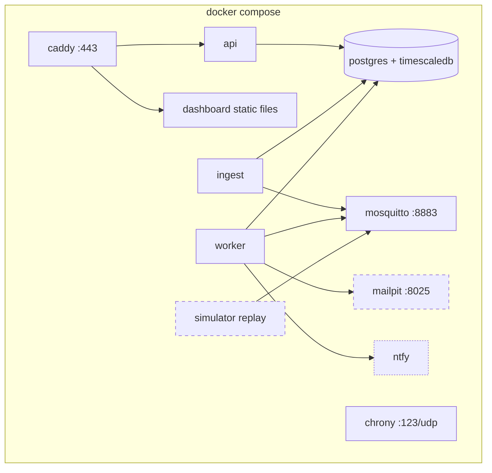

# Deployment and operations

Status: Proposed

Owners: Maria de los Angeles Agudelo (stack, CI), James Tack (backend services), Karen Jimenez (broker, certificates)

## Where it runs

The electrical design connects the node by Ethernet to a "gateway: router / PC". The server stack runs on that PC, or on any Linux machine on the same network: a team laptop for development, an old desktop or mini-PC for the demo. No cloud account is needed.

| Requirement | Minimum |
|---|---|
| OS | Any 64-bit Linux (Debian, Ubuntu, Fedora). Windows/macOS via Podman Desktop or a Linux VM |
| CPU / RAM | 2 cores, 4 GB RAM (8 GB comfortable with ML jobs) |
| Disk | 20 GB free |
| Network | Same LAN as the node, fixed IP or a local DNS name (`gateway.local`) |

## Compose topology



| Profile | Services | Use |
|---|---|---|
| (default) | caddy, mosquitto, db, api, ingest, worker, chrony, dashboard | Real node |
| `dev` | default + simulator replay (5 fake hives) + Mailpit | Development without hardware; everyone's daily setup |
| `demo` | default + `demo_day` scenario replay + ntfy | Final presentation, with or without the real node |

```bash
cp infra/.env.example infra/.env        # fill in passwords
./infra/pki/make-ca.sh                  # once: local CA, server and device certificates
docker compose -f infra/compose.yaml --profile dev up -d
# dashboard on https://localhost, Mailpit on http://localhost:8025
```

Images used: `eclipse-mosquitto:2`, the Apache-2.0 build of TimescaleDB for PostgreSQL (the `-oss` image variant), `caddy:2`, and our own `smarthive-backend` image for `api`, `ingest` and `worker`. Pin exact versions in the Compose file.

## Security

| Area | Measure |
|---|---|
| MQTT transport | TLS on 8883 only; plain 1883 disabled except on the Docker-internal network |
| Certificates | Small local CA created by a script in `infra/pki/` (OpenSSL). Server certificate for `gateway.local`; the CA certificate is installed on the node. Private keys never go into git |
| Device identity | Username = `node_id`, unique password per device (hashed in Mosquitto's password file), topic ACLs per device. Client certificates are an option for later |
| Device HTTP | Bearer token per device for `/device/v1`, stored hashed |
| Users | Argon2id password hashes, short-lived access tokens, refresh token in an `HttpOnly` cookie, rate limit on login |
| Network exposure | Only Caddy (443) and Mosquitto (8883) exposed to the LAN. Database, API and worker on the internal network |
| Secrets | `.env` file on the server, never committed; `.env.example` documents the variables |
| Node | SSH with keys only, password login disabled, firewall allowing outbound only plus SSH from the gateway |

US04 (data protected in transit) is covered by TLS on both MQTT and HTTPS. EL-28 may add requirements.

## Backups

| What | How | How often |
|---|---|---|
| Database | `pg_dump` in custom format from the worker's scheduler to a backup folder | Nightly, keep 14 |
| Images | `rsync` of the image volume | Nightly |
| Node SD card | Full image after a known-good setup | After each node software milestone |
| Restore test | Restore last night's dump into a scratch database and run a row count check | Once per sprint |

### How the nightly job works

The worker runs once a day after `SMARTHIVE_MAINTENANCE_HOUR_UTC` (default 3). It first drops `node_health` chunks older than 90 days and images past `expires_at` (the files too, unless another image row still uses the same file), then, if `SMARTHIVE_BACKUP_DIR` is set, writes `smarthive-YYYYMMDD-HHMMSS.dump` there and keeps the newest `SMARTHIVE_BACKUP_KEEP` (default 14). Next to each dump it saves a `.json` file with the row counts taken just before the dump. The backend image carries `pg_dump` and `pg_restore` 16, matching the database image.

Run the same steps by hand:

```bash
docker compose exec worker smarthive backup                          # prints the dump path
docker compose exec worker smarthive restore-check /backups/<file>.dump
```

`restore-check` restores into a scratch database, compares the row counts with the saved ones, drops the scratch database, and exits non-zero if any table came back short. Run it before every sprint review. The image volume still needs its own nightly `rsync`; the worker does not copy images.

## CI

GitHub Actions, free for public repositories:

| Workflow | Runs |
|---|---|
| `lint` | Ruff, mypy, markdownlint, prettier |
| `test-backend` | pytest with Testcontainers (real PostgreSQL + TimescaleDB, real Mosquitto) |
| `test-edge` | Node software against fake hardware and the broker container |
| `test-simulation` | Stylized-fact tests, determinism check |
| `contracts` | Validate every schema example and fixture; generate types and fail if the committed ones are stale |
| `e2e` (nightly) | Full Compose stack, simulator replays a scripted day, asserts that the expected alerts were raised |
| `docs` | Link check on `docs/` |

## Observability

Enough to answer "is it working?" during a demo, without a monitoring project:

- Structured JSON logs from every Python service (`structlog` or the standard library with a JSON formatter).
- `/healthz` and `/readyz` on the API; Compose health checks on every service.
- An admin page in the dashboard: node status, last message per node, outbox backlog, broker connections, recent errors.
- Optional: Prometheus and Grafana in a `monitoring` profile.

## Runbook (first version)

| Symptom | Check |
|---|---|
| Node shows offline | `status` topic retained message; ping the node; health history for under-voltage before silence |
| Data arrives with odd timestamps | `clock_synced` flags; chrony status on the node and gateway |
| No email notifications | Mailpit in dev; worker logs; `notifications` rows with `failed` status |
| Charts have gaps | Normal if the node was offline; check `outbox_pending` in health after reconnection |
| Disk filling up | `du -sh` on the backup and image volumes; `docker compose logs worker \| grep -E "purged|backup_written|nightly_failed"` shows what the last night did |
| No backup file this morning | `docker compose logs worker \| grep nightly_failed`; run `smarthive backup` by hand and read the error (`pg_dump failed: ...`) |
| Duplicate-looking data | Should be impossible (primary key on `msg_id`); if seen, check the node's `msg_id` generation |
