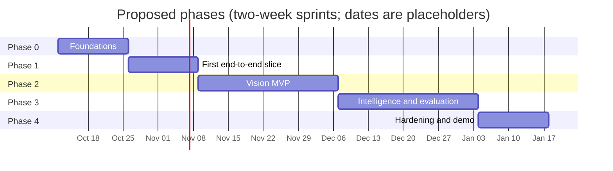

# Roadmap

Status: Proposed, updated after Sprint 3. The sprint-by-sprint version, with every story, sub-task, estimate and owner, is the [Jira backlog](jira/backlog.md).

This is the plan for the whole project, including the parts that are designed in these docs and the parts that are only proposed. Phases are in two-week sprints. The sprint count per phase is an estimate; the order matters more than the dates.

## What is designed and what is not

| Area | Owner | State of the docs | Next document to write |
|---|---|---|---|
| Project, requirements | Adrien (PO), Diego (SM) | Done, waiting for client answers; Jira backlog ready | Interview log after the client meeting |
| Hardware Prototype 1 | Ricardo | Done (from the design document) + review notes | Measured power budget; enclosure design |
| Data strategy and telemetry simulator | Diego, James | **Implemented** (v1.0.0, tested) | Calibration against MSPB; MQTT replay |
| Synthetic images and vision | Adrien | **Implemented v0.1**: procedural generator, two-stage model trained, ncnn export, Pi estimate | Real backgrounds (tier C), on-device benchmark, public Varroa data |
| Backend | James | **Designed in detail** | Code |
| Communications | Karen | Contract designed; link study not started | LoRaWAN / NB-IoT feasibility study |
| Frontend | Maria | API ready to consume; UI not designed | Dashboard design doc |
| Time-series ML | Diego | Data side designed; models not designed | Anomaly detection design doc |
| Acoustics | Adrien | Not started; no microphone in Prototype 1 | Decision: keep or drop for this semester |
| DevOps, CI | Maria | Designed (deployment doc) | Code |
| Testing strategy | All | Spread across docs | Test plan for the final demo |

## Phases

### Phase 0: Foundations (1 sprint)

Goal: everyone can work in parallel without waiting for anyone.

| Item | Owner | Done when |
|---|---|---|
| Client interview (30 questions) | Adrien | Interview log filled in; docs updated where answers change assumptions |
| Freeze messaging contract v1, JSON Schemas, example fixtures | Karen, James | Schemas merged; contract tests run in CI |
| Docker Compose skeleton: Mosquitto with TLS, PostgreSQL + TimescaleDB, empty API | Maria, James | `docker compose --profile dev up` works on every laptop |
| ~~Telemetry simulator v0~~ Done ahead of plan as v1.0.0 (weight, events, node model included) | Diego | Six scenarios, 10 stylized-fact tests |
| Choose the camera; mount it; tier C captures (backgrounds, gray card, ruler) | Ricardo, Adrien | 200+ background frames in DVC |
| ~~Download and license-check public datasets; freeze P splits~~ Done: iNaturalist P-inat-v1. Zenodo Varroa sets still to fetch from a machine with access | Adrien | Split file committed |
| ~~Decide repository license (ADR-0008)~~ Done: Ultralytics YOLO11, repository AGPL-3.0 | Team | Decision recorded |
| Update presentation and backlog to the Pi 3B design (ADR-0003) | Ricardo | No more contradictions between documents |

### Phase 1: First end-to-end slice (1 sprint)

Goal: a reading from a real DHT11 and from a fake node both show up on a chart.

| Item | Owner | Stories |
|---|---|---|
| Node: `sensord` with kernel DHT11 driver, outbox, `uplinkd` | Ricardo, Karen | US01, US03, US05 |
| Ingestor with dedup; readings API; WebSocket live values | James | US05, US13 |
| Simulator MQTT replay with node behaviors (outages, duplicates) | James, Diego | EN-02 |
| Dashboard v0: hive list, latest values, 24 h chart | Maria | US13 |
| ~~Image compositor v0.1, first TSTR number~~ Done in Sprint 3 | Adrien | EN-04 |
| Pi 3B inference benchmark: estimate done, on-device run pending the Pi | Adrien, Ricardo | US11 |
| CI: lint, unit tests, contract tests | Maria | |

### Phase 2: Vision MVP (2 sprints)

Goal: a hornet or a Varroa-positive bee in front of the camera (synthetic or real) becomes an email.

| Item | Owner | Stories |
|---|---|---|
| ~~Generator v0.2 and v0.3: real-photo cutouts, more distractors~~ Done in Sprint 3 | Adrien | EN-10, EN-11 |
| ~~Model v0.4: real photos with automatic labels~~ Done in Sprint 3; model v0.4 released (tier P 0.73) | Adrien | EN-13 |
| Model v0.5: real board backgrounds, newer iNaturalist snapshot, hard negatives, per-class thresholds, 416 px trial; INT8 only if the on-device benchmark needs it | Adrien, Diego | EN-12, US09, US10, US11 |
| Generator sequences, to measure false threat events per day | Adrien | US10 |
| `camd` with motion gating and night mode; `visiond` with aggregation | Ricardo, Adrien | US07, US08, US11 |
| Image upload endpoint and storage; latest image view | James, Maria | US15 |
| Alert engine, lifecycle, email and in-app notifications | James, Maria | US12, US14 |
| Node offline detection (last will + heartbeat) | James, Karen | US06 |
| Alert history UI | Maria | US14 |

### Phase 3: Intelligence and evaluation (2 sprints)

Goal: honest numbers, and at least one time-series model working on synthetic data.

| Item | Owner | Stories |
|---|---|---|
| Simulator v1: weight model, colony events, calibration against published curves | Diego | EN-01 |
| Anomaly detection baseline (rules + an unsupervised model), evaluated on known and novel events | Diego | US16, US17 |
| Weight-based rules on simulated nodes (sudden drop) | James | |
| Varroa index with confidence interval in the API and dashboard | Adrien, Maria | US09 |
| Sim-to-real evaluation report for vision: tiers S, P, C | Adrien | REQ-16 |
| Yield prediction proof of concept with prediction ranges (only if Phase 2 finished on time) | Diego | US18, US19, US20 |
| Beekeeper log (management events) in API and UI | James, Maria | |

### Phase 4: Hardening and demo (1 sprint)

| Item | Owner |
|---|---|
| Install the node on a real or simulated hive (REQ-15); measure power; 48 h soak test | Ricardo |
| `demo_day` scenario and demo profile | Diego, Maria |
| Backups, runbook, restore test | Maria |
| Final report: results per data tier, domain gap, limitations | Everyone |

## Proposed work not yet designed

These need their own documents before implementation. Each entry says what the document should answer.

### Communications (Karen)

- Link study for Prototype 2. LoRaWAN with a self-hosted ChirpStack network server versus NB-IoT versus Wi-Fi with a directional antenna, for the actual apiary distance and coverage (R3). Payload sizes from the [messaging contract](05-backend/04-messaging-contract.md#ready-for-a-constrained-link), duty cycle limits, gateway hardware already available.
- CBOR encoding and a ChirpStack-to-MQTT bridge, only if LoRaWAN is chosen.
- Broker hardening: client certificates, connection limits, persistence settings.

### Frontend (Maria)

- Dashboard design: screens (overview, hive detail, alerts, image gallery, admin), wireframes, the simulated-data badge, mobile layout (EL-27 assumption: responsive web).
- Framework choice: SvelteKit or React + Vite; charting with ECharts or uPlot; generated API client.
- Accessibility and offline behavior of the dashboard on poor mobile connections.

### Time-series ML (Diego)

- Anomaly detection design: features (daily weight delta, morning drop, afternoon gain, thermal stability, humidity trend), candidate models (robust z-scores and seasonal baselines first, then Isolation Forest or a small autoencoder), event-level evaluation as in [scenarios](04-data/03-scenarios-and-events.md#for-anomaly-detection-us16-us17).
- Yield model design: target definition after EL-10, baselines, quantile regression for ranges (US19), weather features from Open-Meteo forecasts (US20).
- Recommendation rules for supers and harvest (US21, US22).

### Vision, later stages (Adrien)

- Temporal tracking of bees across frames to count individuals for the Varroa index.
- Server-side second opinion with a larger model on uploaded images.
- Fusion of visual detections with telemetry anomalies into a risk level, as the original proposal described.
- 3D rendering route (BlenderProc), only if the compositor plateaus.

### Acoustics (Adrien)

- Decide at the end of Phase 1 whether acoustic swarm detection stays in scope this semester. It needs a microphone, has no data, and synthetic hive audio is much harder to make convincing than images. If kept: public datasets (Nolasco and Benetos 2018, MSPB audio) for a proof of concept on a laptop, not on the node.

### Hardware, Prototype 2 (Ricardo)

- Load cell + HX711 (US02, and everything weight-based).
- INA219 battery monitor (US06 power alert).
- DS3231 real-time clock.
- Power: PoE-style feed over the existing cable for the demo, then solar sizing.
- Enclosure: materials for humidity and propolis (NFR-04, NFR-07), ventilation for the Pi and the buck converter, sensor cable into the hive.
- Optional split node: ESP32 for sensors, Pi for vision.

### Platform (James, Maria)

- OTA updates (REQ-14): signed packages pulled by the node, health check after update, automatic rollback.
- Multi-user sharing of apiaries, if EL-01 asks for it.
- Data export for researchers in a documented format with a data dictionary.

## Dependencies to watch

| Waiting on | Blocks |
|---|---|
| Client answers (EL-xx) | Final thresholds, alert channels, retention, demo scope. Work continues on working assumptions |
| Camera choice | Compositor geometry, stage 2 resolution, power numbers |
| Benchmark spike (EN-06) | Detector choice, repository license |
| Load cell | Weight on the real node; everything weight-based runs on the simulator until then |
